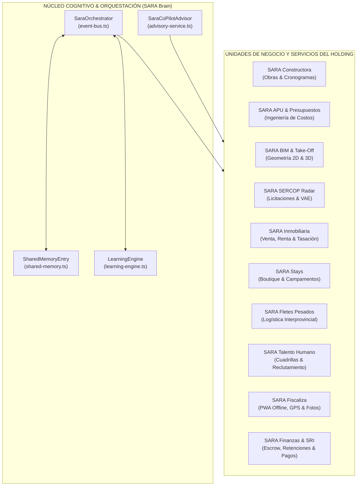
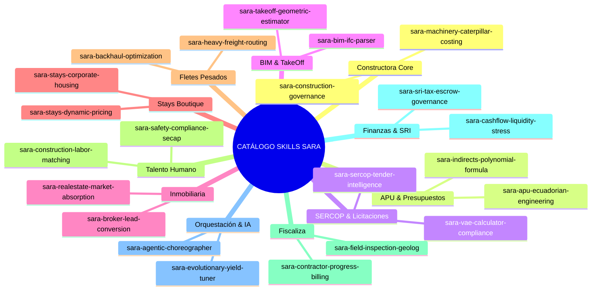
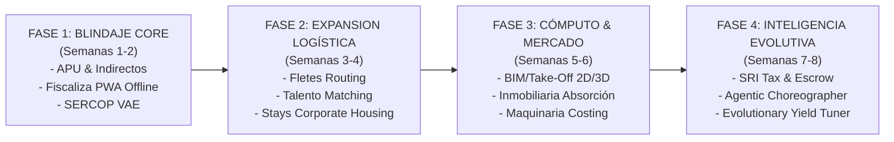

# INFORME DE AUDITORÍA TÉCNICA DEL ECOSISTEMA GRUPO SARA
## Arquitectura de Software, Ecosistema Multi-Agente y Catálogo Maestro de Skills Operativas
**Autor:** Skills Architect & Chief Technology Officer de GRUPO SARA  
**Fecha:** Octubre 2026 | **Versión:** 2.0 Enterprise  
**Repositorio Base:** `d:\SaS_Proyectos\sara-constructora`  
**Entorno Tecnológico:** Next.js 16.3.4 (App Router) · React 19.2.8 · Supabase SSR & RLS · Tailwind CSS v4 · PWA Offline-First · Red de Agentes Coreografiados

---

## 1. RESUMEN EJECUTIVO & RADIOGRAFÍA DEL ECOSISTEMA

GRUPO SARA opera como un holding tecnológico e inmobiliario-constructor verticalmente integrado. La plataforma ha sido concebida bajo una arquitectura modular donde convergen once (11) unidades de negocio interconectadas mediante un **Bus de Eventos Asíncrono** (`SaraAgentEvent`), una **Capa de Memoria Compartida** (`SharedMemoryEntry`), y un **Motor de Aprendizaje Evolutivo** (`EvolutionaryKnowledge`).

El ecosistema no es un CRM genérico ni un gestor documental estático; es un **Sistema Operativo Autónomo de Construcción e Ingeniería Civil (AEC OS)** adaptado 100% al marco normativo, tributario y geográfico de la República del Ecuador (LOSNCP, SERCOP, normativa CICS, tablas sectoriales IESS, tarifarios SRI y metodologías de maquinaria CATERPILLAR/MOP).

---

## 2. AUDITORÍA DE ARQUITECTURA TÉCNICA EXISTENTE

### 2.1 Stack Tecnológico & Capa Base
- **Frontend Framework:** Next.js 16.3.4 (App Router con Server Components y Client Islands optimizados para React 19.2.8).
- **Estilos & UI System:** Tailwind CSS v4 con CSS Variables dinámicas de marca (`--primary`, `--primary-dark`, `--font-display`, `--font-sans`). Reglas estrictas de calidad editorial según `.agents/rules/design-rules.md`.
- **Backend & Almacenamiento:** Supabase PostgreSQL con SSR (`@supabase/ssr` 0.12.7), Row Level Security (RLS) multitenant segregado por empresa/proyecto, extensiones PostGIS para geolocalización y Supabase Storage para expedientes y fotografías de obra.
- **Motor de Renderizado Documental:** jsPDF 4.2.1 + `jspdf-autotable` 5.0.8 con soporte embebido para membretes institucionales vectorizados en base64 (`membreteBase64.ts`), garantizando entregables oficiales para SERCOP y fiscalizadores.
- **Visualización & Gráficos:** Recharts 3.10.1 para dashboards financieros/SRI, Gantt-task-react para cronogramas críticos de obra, Leaflet + React-Leaflet para ruteo logístico de fletes y mapas de frentes de trabajo.
- **Motor Geométrico Take-Off:** Motor trigonométrico custom en `src/lib/takeoff/geometry.ts` con algoritmo de la fórmula de Gauss (Shoelace Formula) para polígonos, deducción paramétrica de vanos y cubicación de mampostería.

### 2.2 Auditoría de Endpoints API (`src/app/api`)
| Ruta de Endpoint | Método | Función Principal | Estado de Seguridad / RLS |
| :--- | :--- | :--- | :--- |
| `/api/agents/orchestrator` | `POST` | Despacho de eventos multi-agente en cascada | Protegido con Service Role / JWT |
| `/api/agents/advisory` | `POST` | Generación de auditorías ejecutivas de proyectos | Validación de rol administrador |
| `/api/agents/learning` | `GET/POST` | Extracción de varianzas y evolución de rendimientos | Registro histórico en log tables |
| `/api/tenders/analizar-pliego`| `POST` | Parseo automatizado de PDFs de pliegos SERCOP | Extracción heurística y de scoring |
| `/api/takeoff/mediciones` | `GET/POST` | Almacenamiento y vinculación de geometrías con APUs | Filtrado por `proyecto_id` |
| `/api/fiscaliza/reporte-diario`| `POST` | Recepción de bitácoras de campo con coordenadas | Validación offline / sync posterior |
| `/api/fiscaliza/evidencia-foto`| `POST` | Upload de fotografías con marca de agua y GPS | Bucket seguro con RLS |
| `/api/dashboard-sri` | `GET` | Agregación de ventas, compras, retenciones e IVA | Acceso restringido rol financiero |
| `/api/pagos/kushki` & `/stripe`| `POST` | Webhooks de pasarelas para cuentas escrow | Firma criptográfica de webhook |
| `/api/airbnb/alojamientos` | `GET/POST` | Disponibilidad, reservas y check-in digital | Multitenant con rol `owner` / `guest` |

---

## 3. AUDITORÍA DETALLADA POR UNIDAD DE NEGOCIO Y SERVICIO

### 3.1 SARA CONSTRUCTORA (Obras, Infraestructura & Gestión de Maquinaria)
- **Alcance Operativo:** Control maestro de proyectos civiles, residenciales, comerciales e industriales. Gestión del parque automotor y maquinaria pesada con costeo horario (costos de posesión y operación CATERPILLAR).
- **Módulos Activos:** `src/app/constructora`, `src/app/dashboard/maquinaria`, `src/app/admin/proyectos`, `src/app/admin/trabajadores`.
- **Fortalezas Identificadas:** Cálculo paramétrico de depreciación horaria de maquinaria, combustible, lubricantes y operadores.
- **Cuellos de Botella Detectados:** Falta de un agente que alerte proactivamente sobre vencimientos de mantenimiento preventivo y desajustes de consumo real de combustible vs estándar teórico en frentes de obra remotos.

### 3.2 SARA APU & PRESUPUESTOS REALES (Ingeniería de Costos)
- **Alcance Operativo:** Desglose riguroso de precios unitarios (Materiales, Mano de Obra con beneficios sociales de ley en Ecuador, Equipos y Transporte).
- **Módulos Activos:** `src/app/dashboard/presupuestos_reales`, `src/lib/apuRecipeGenerator.ts`, `src/lib/calculadoras/presupuestos.ts`.
- **Fortalezas Identificadas:** Modal de Desglose Analítico de Indirectos (`IndirectosAnaliticoModal.tsx`) que calcula campamento, personal técnico, pólizas y ensayos de laboratorio. Slide-over interactivo de edición profunda de recetas APU (`ApuSlideOverDetail.tsx`).
- **Oportunidad de Mejora:** Ajustar automáticamente los rendimientos de cuadrilla según la altitud y clima provincial (Sierra vs Costa húmeda vs Amazonía).

### 3.3 SARA SERCOP & RADAR DE LICITACIONES PÚBLICAS
- **Alcance Operativo:** Detección de oportunidades de contratación pública, análisis de pliegos, cálculo del VAE (Valor Agregado Ecuatoriano) y asesoría legal bajo la LOSNCP y RGLOSNCP.
- **Módulos Activos:** `src/app/dashboard/sercop/radar`, `src/app/dashboard/sercop/agente`, `src/app/dashboard/sercop/vae`, `src/app/dashboard/presupuestos_reales/components/SercopVaeAnalyzer.tsx`.
- **Fortalezas Identificadas:** Algoritmo VAE que desglosa insumos nacionales vs extranjeros según códigos CPC oficiales. Agente normativo con conocimiento de articulado vigente (anticipos, inhabilidades, multas, liquidación de contratos).

### 3.4 SARA BIM & TAKE-OFF (CÓMPUTOS MÉTRICOS 2D / 3D)
- **Alcance Operativo:** Digitalización de planos en PDF o imagen para extracción de cantidades de obra (áreas de losas, enlucidos, pintura, mampostería deduciendo puertas/ventanas, longitudes de tubería y conteo de puntos eléctricos/hidráulicos). Visualización de modelos IFC 3D.
- **Módulos Activos:** `src/app/dashboard/takeoff`, `src/app/dashboard/bim`, `src/lib/takeoff/geometry.ts`.
- **Fortalezas Identificadas:** Calibración milimétrica por cota real conocida; integración directa del resultado geométrico a la cantidad (`cantidad_obra`) del APU respectivo.

### 3.5 SARA INMOBILIARIA (Comercialización, Absorción y Corretaje)
- **Alcance Operativo:** Portal de proyectos inmobiliarios, departamentos, lotizaciones e inmuebles corporativos. Gestión de suscripciones y planes para agentes y brokers independientes.
- **Módulos Activos:** `src/app/(public)/inmobiliaria`, `src/app/admin/inmobiliaria`, `src/lib/services/inmueblesService.ts`.
- **Fortalezas Identificadas:** Base de datos estructurada con características detalladas, filtros geográficos por cantón y provincia, y control de estados (Disponible, Reservado, Vendido).

### 3.6 SARA STAYS (Hospitalidad Boutique & Campamentos de Obra)
- **Alcance Operativo:** Doble propósito: renta corta turística de alto ticket + campamentos corporativos y suites para ingenieros residentes y cuadrillas desplazadas.
- **Módulos Activos:** `src/app/(public)/stays`, `src/app/api/airbnb/*`, `src/lib/services/staysPoliciesService.ts`.
- **Fortalezas Identificadas:** Gestión de depósitos de garantía, reglas de check-in autónomo con cerraduras electrónicas PIN y liquidación de costos de estancia imputables a los costos indirectos de la obra.

### 3.7 SARA FLETES (Logística de Transporte Pesado)
- **Alcance Operativo:** Orquestación de volquetas (14m3), mulas plataforma, camiones 10T y camas bajas para transporte de materiales áridos, cemento, varillas de acero y maquinaria.
- **Módulos Activos:** `src/app/modulos/fletes`, `src/app/admin/fletes`, `src/components/sara/DriverFreightMap.tsx`, `src/components/sara/LogisticsPanel.tsx`.
- **Fortalezas Identificadas:** Cálculo dinámico de costo logístico por distancia y peso; estimación de tiempos de viaje y ruteo interprovincial.

### 3.8 SARA TALENTO HUMANO (Bolsa de Empleo y Cuadrillas)
- **Alcance Operativo:** Reclutamiento ágil de operarios, albañiles, fierreros, maestros mayores y residentes técnicos de obra. Validación de certificaciones SECAP y títulos profesionales.
- **Módulos Activos:** `src/app/modulos/talento`, `src/app/admin/talento`, `src/components/sara/TalentMatching.tsx`.
- **Fortalezas Identificadas:** Matching por proximidad geográfica a la ubicación física de la obra, reduciendo costos de viáticos y retrasos de movilización.

### 3.9 SARA FISCALIZA (Supervisión, Georreferenciación & Libro de Obra)
- **Alcance Operativo:** PWA móvil para residentes y fiscalizadores con capacidad de operar sin conexión a internet en quebradas o zonas rurales sin cobertura móvil.
- **Módulos Activos:** `src/app/dashboard/fiscaliza`, `src/app/api/fiscaliza/*`.
- **Fortalezas Identificadas:** Captura de bitácora con geolocalización satelital obligatoria, sellado de tiempo UTC, registro climático (lluvia, despejado) y cubicación de avance real para generación de planillas.

### 3.10 SARA FINANZAS, PAGOS & SRI (Gobernanza Contable y Escrow)
- **Alcance Operativo:** Facturación electrónica, retenciones en la fuente según códigos de retención del SRI (312, 332, bienes/servicios), conciliación bancaria y blindaje financiero con cuentas de custodia (Escrow) liberadas contra hitos técnicos de fiscalización.
- **Módulos Activos:** `src/app/dashboard/metricas-sri`, `src/components/sara/DashboardFinanciero.tsx`, `src/components/sara/PaymentGatewayModal.tsx`.

---

## 4. CATÁLOGO MAESTRO DE SKILLS A IMPLEMENTAR

Para convertir el ecosistema en un clúster autónomo de alta eficiencia, se diseñan las siguientes **veintidós (22) Skills Especializadas**, agrupadas por unidad de negocio. Cada skill cumple con el estándar de arquitectura Antigravity: directiva operativa clara, mitigación anti-plantilla, automatizaciones dirigidas por eventos y métricas de impacto tangibles.

---

### BLOQUE 1: CONSTRUCTORA & MAQUINARIA

#### Skill 1: `sara-construction-governance`
* **Descripción:** Orquesta la gobernanza integral de proyectos de obra civil, validando cronogramas críticos (PERT/CPM), compatibilidad de especificaciones técnicas y trazabilidad de hitos de obra.
* **Instrucciones Operativas:**
  1. Al recibir un evento `PROYECTO_CREADO`, inicializar el cronograma maestro y desglosar las fases: Preliminares, Estructura, Mampostería, Instalaciones, Acabados y Obra Exterior.
  2. Verificar que cada fase cuente con cuadrillas asignadas y fechas tempranas/tardías calculadas.
  3. Ejecutar análisis de ruta crítica continua; si un rubro crítico se retrasa más de 48 horas en `SARA Fiscaliza`, recalcular la fecha final de entrega y emitir un memo de mitigación contractual.
* **Estándar Visual & Ergonomía:** Tableros visuales de alta jerarquía tipográfica (`--font-display` en hitos mayores, micro-detalles en `--font-sans`). Sin tablas genéricas grises; uso de badges con bordes sutiles y tintes cromáticos según el estado de la fase.
* **Automatización:** Emite alerta por correo y webhook cuando la variación del cronograma supere el 5% del plazo contractual pactado.

#### Skill 2: `sara-machinery-caterpillar-costing`
* **Descripción:** Calcula con precisión matemática el costo horario posesión/operación de maquinaria amarilla (retroexcavadoras, motoniveladoras, rodillos, cargadoras, tractores) bajo el estándar oficial Caterpillar / MOP del Ecuador.
* **Instrucciones Operativas:**
  1. Extraer potencia en HP, vida útil en horas, valor residual de reventa y costo de neumáticos o tren de rodaje.
  2. Computar costo fijo horario: Interés del capital, seguros, depreciación neta y bodegaje.
  3. Computar costo variable horario: Consumo de combustible diésel (galones/h según factor de carga liviano, mediano o pesado), filtros (lubricante, aire, hidráulico), grasas y salario del operador certificado.
  4. Inyectar automáticamente el costo horario resultante en la base de datos de insumos de equipo de `SARA APU`.
* **Automatización:** Actualiza el costo horario de todo el parque automotor de forma instantánea ante cambios en el precio oficial del galón de Diésel fijado por decreto ministerial.

---

### BLOQUE 2: APU & PRESUPUESTOS REALES

#### Skill 3: `sara-apu-ecuadorian-engineering`
* **Descripción:** Motor de formulación de análisis de precios unitarios con rendimientos calibrados para las 24 provincias del Ecuador, aplicando salarios del sector de la construcción (CICS) vigentes.
* **Instrucciones Operativas:**
  1. Al crear o modificar un rubro, verificar que contenga los 4 componentes: Materiales, Mano de Obra, Equipos y Transporte.
  2. En Mano de Obra, verificar que las categorías laborales respeten la tabla de salarios mínimos sectoriales del Ministerio de Trabajo del Ecuador (categoría Peón, Albañil, Fierrero, Maestro Mayor) agregando el factor de costos indirectos de personal (décimos, fondos de reserva, IESS patronal).
  3. Aplicar factor de ajuste bioclimático al rendimiento diario: Sierra alta (-10% por oxígeno y temperatura), Costa húmeda (-5% en jornadas vespertinas por índice térmico), Amazonía (-15% por pluviosidad extrema).
  4. Generar el PDF institucional con membrete oficial vectorizado, código QR de verificación de autenticidad y firmas de responsabilidad técnica.
* **Automatización:** Ejecuta recálculo en lote de todos los presupuestos activos cuando se actualice el salario básico unificado o la tabla sectorial de la construcción.

#### Skill 4: `sara-indirects-polynomial-formula`
* **Descripción:** Modela la estructura analítica de costos indirectos del proyecto y formula la Fórmula Polinómica de reajuste de precios bajo el estándar del SERCOP.
* **Instrucciones Operativas:**
  1. Abrir desglose de indirectos distribuyendo partidas en 5 categorías obligatorias: Personal Técnico/Administrativo, Instalaciones Provisionales, Pólizas de Seguro, Laboratorios/Ensayos y Utilidad/Imprevistos.
  2. Determinar los coeficientes de incidencia ($A, B, C, D, E$) agrupando insumos por familias de índices del INEC (mano de obra, acero, cemento, equipo nacional, equipo importado).
  3. Validar que la sumatoria de coeficientes de la fórmula polinómica sea exactamente $1.00000$ ($ \sum Coef = 1.00000 $).
  4. Exportar el anexo de indirectos y cuadrilla tipo en formato PDF autotable firmado digitalmente.

---

### BLOQUE 3: SERCOP & RADAR DE LICITACIONES

#### Skill 5: `sara-sercop-tender-intelligence`
* **Descripción:** Monitoriza, categoriza y evalúa procesos de licitación en el portal del SERCOP (Menor Cuantía, Cotización, Licitación, Subasta Inversa de Obras), calculando un Score de Idoneidad para GRUPO SARA.
* **Instrucciones Operativas:**
  1. Consumir las publicaciones del portal SERCOP e indexar: Entidad contratante, presupuesto referencial, plazo, provincia, CPC y porcentaje de anticipo.
  2. Analizar el pliego contractual y evaluar 5 dimensiones críticas: Experiencia mínima requerida vs portafolio del holding, disponibilidad de personal técnico calificado, maquinaria solicitada en propiedad/arriendo, patrimonio técnico y plazo de ejecución.
  3. Emitir el veredicto del Radar: `ALTA RECOMENDACIÓN` (Score > 85), `MODERADA` (Score 70-84) o `DESCARTAR` (Score < 70).
  4. Generar la hoja de ruta con el cronograma fatal de preguntas, respuestas, aclaraciones y fecha máxima de entrega de ofertas técnicas/económicas.

#### Skill 6: `sara-vae-calculator-compliance`
* **Descripción:** Audita y certifica el Valor Agregado Ecuatoriano (VAE) de la oferta técnica, garantizando el cumplimiento del umbral mínimo exigido en los pliegos del proceso.
* **Instrucciones Operativas:**
  1. Cruzar cada insumo del presupuesto con la base de datos de producción nacional catalogada por el SERCOP y el MIPRO.
  2. Asignar el clasificador CPC del proceso licitado.
  3. Calcular el VAE directo:
     $$\text{VAE} = \frac{\sum (\text{Costo Insumos Nacionales} + \text{Mano de Obra Local})}{\text{Costo Directo Total}} \times 100$$
  4. Si el VAE calculado se encuentra por debajo del umbral mínimo del pliego, sugerir al proyectista sustituciones inmediatas de insumos importados por equivalentes nacionales homologados (ej: perfilería de acero nacional, tubería PVC local, pinturas nacionales).
  5. Generar el Anexo Formulario 1.4 de Declaración de Valor Agregado Ecuatoriano en PDF listo para firma electrónica.

---

### BLOQUE 4: BIM & TAKE-OFF (CÓMPUTOS MÉTRICOS)

#### Skill 7: `sara-takeoff-geometric-estimator`
* **Descripción:** Motor de cubicación y cómputo métrico interactivo sobre planos PDF y raster, vinculando mediciones 2D directamente con las partidas de obra del presupuesto APU.
* **Instrucciones Operativas:**
  1. Requerir calibración de escala obligatoria mediante dos puntos de referencia y una cota dimensional real en metros.
  2. Proveer 4 modos de medición de alta precisión:
     - **Área Poligonal:** Cálculo por fórmula Shoelace con snapping visual a vértices para losas, contrapisos y techumbres.
     - **Muros/Paredes:** Medición de longitud lineal con multiplicación por altura libre de entrepiso y deducción paramétrica de vanos (puertas y ventanas).
     - **Longitud Lineal:** Trazado de redes de tubería sanitaria, eléctrica, tubería de gas o bordillos.
     - **Conteo Puntual:** Marcado de luminarias, cajas de revisión, tomacorrientes o salidas de voz/datos.
  3. Inyectar automáticamente el resultado métrico (`m²`, `m`, `u`) en la celda `cantidad_obra` del rubro correspondiente en `presupuesto_rubros`.
* **Ergonomía UI:** Canvas interactivo con soporte de zoom fluido, capas cromáticas semitransparentes para no tapar el plano estructural y panel deslizante (Slide-Over) con el resumen de mediciones.

#### Skill 8: `sara-bim-ifc-parser`
* **Descripción:** Analizador de modelos BIM en formato IFC/glTF para cubicación 3D automática de volúmenes de hormigón armado, tonelaje de acero de refuerzo y superficie de encofrado.
* **Instrucciones Operativas:**
  1. Leer la estructura jerárquica del archivo IFC (`IfcProject` $\rightarrow$ `IfcBuilding` $\rightarrow$ `IfcBuildingStorey` $\rightarrow$ `IfcProduct`).
  2. Clasificar elementos estructurales: Columnas (`IfcColumn`), Vigas (`IfcBeam`), Losas (`IfcSlab`), Zapatas (`IfcFooting`) y Muros (`IfcWall`).
  3. Extraer cantidades geométricas netas descontando intersecciones de nudos estructurales para evitar sobreestimación de volúmenes de hormigón.
  4. Cotejar el volumen total cubicado en el modelo 3D con el presupuesto APU consolidado, resaltando desviaciones superiores al 2%.

---

### BLOQUE 5: INMOBILIARIA & DESARROLLO URBANO

#### Skill 9: `sara-realestate-market-absorption`
* **Descripción:** Modelo econométrico de tasación inmobiliaria, análisis de plusvalía y predicción de velocidad de absorción comercial de proyectos residenciales y comerciales.
* **Instrucciones Operativas:**
  1. Levantar datos de valor por metro cuadrado ($USD/m^2$) de terrenos y unidades terminadas en la zona de influencia del proyecto.
  2. Determinar la estructura de costos: Incidencia del suelo + Costo directo de construcción + Costos indirectos + Gastos de comercialización + Costo financiero.
  3. Calcular el precio de venta sugerido por tipología (suites, 2 dormitorios, 3 dormitorios, locales comerciales) maximizando la tasa interna de retorno (TIR) y el valor actual neto (VAN).
  4. Simular escenarios de absorción: Escenario Conservador (ej: 2.5 unidades/mes), Moderado (4 unidades/mes) y Agresivo (6 unidades/mes), generando la curva de flujo de caja inmobiliario.

#### Skill 10: `sara-broker-lead-conversion`
* **Descripción:** Automatiza el pipeline comercial de corretaje, asignación de prospectos a brokers certificados y gestión de contratos de reserva y promesa de compraventa.
* **Instrucciones Operativas:**
  1. Capturar leads provenientes del portal público inmobiliario y clasificarlos por perfil crediticio y capacidad de entrada (ej: crédito hipotecario BIESS vs Banca Privada vs Pago de Contado).
  2. Notificar al broker asignado en menos de 5 minutos mediante mensaje enriquecido con la ficha técnica del inmueble cotizado.
  3. Generar la proforma de pago personalizada con tabla de amortización simulada y condiciones de reserva.
  4. Al concretarse la reserva, bloquear automáticamente el inmueble en la base de datos central de `SARA Inmobiliaria` para prevenir duplicidad de ventas.

---

### BLOQUE 6: STAYS & HOSPITALIDAD BOUTIQUE

#### Skill 11: `sara-stays-corporate-housing`
* **Descripción:** Gestiona y optimiza el alojamiento temporal de cuadrillas de obra, directores de proyecto e ingenieros consultores en alojamientos propios o asociados.
* **Instrucciones Operativas:**
  1. Al dispararse el evento `CONVOCATORIA_TALENTO_EMITIDA` con personal foráneo confirmado, consultar la disponibilidad de plazas en propiedades de `SARA Stays` cercanas al frente de obra.
  2. Bloquear habitaciones o casas operativas por el periodo requerido en el cronograma de obra.
  3. Generar la orden de estancia interna con imputación directa al centro de costos de gastos indirectos de la obra correspondiente.
  4. Despachar al smartphone del ingeniero residente el código PIN de acceso autónomo a la cerradura inteligente y la guía de servicios del alojamiento.

#### Skill 12: `sara-stays-dynamic-pricing`
* **Descripción:** Algoritmo de tarificación dinámica para alojamientos boutique de renta corta turística según estacionalidad, feriados nacionales, ocupación y demanda de la plaza.
* **Instrucciones Operativas:**
  1. Monitorear el calendario oficial de feriados del Ecuador (Carnaval, Semana Santa, Fiestas Patrias, Navidad, Fin de Año) y eventos masivos locales.
  2. Ajustar la tarifa por noche ($ADR$) con un multiplicador de demanda entre $1.15$ y $1.60$ durante fechas pico.
  3. Implementar reglas de estancia mínima (ej: mínimo 3 noches en feriados nacionales).
  4. Activar descuentos automáticos de última hora (`last-minute discount`) para fechas intermedias vacías a menos de 48 horas de la fecha de estancia para maximizar ocupación global (Target RevPAR > $82\%$).

---

### BLOQUE 7: FLETES & LOGÍSTICA PESADA

#### Skill 13: `sara-heavy-freight-routing`
* **Descripción:** Planifica y despacha convoyes de transporte de carga pesada (volquetas, plataformas, camiones) evaluando restricciones de peso por eje, peajes y estado vial del MTOP.
* **Instrucciones Operativas:**
  1. Recibir del evento `APU_CONSOLIDADO` el peso total en toneladas y volumen en metros cúbicos de materiales áridos, cemento y acero requeridos por el proyecto.
  2. Calcular el número óptimo de viajes y seleccionar el vehículo apropiado: Volquetas de 14m³ para agregados pétreos, mulas plataforma de 30T para varillas de acero, furgones cerrados para sacos de cemento y acabados delicados.
  3. Trazar la ruta geográfica óptima entre las canteras/fábricas proveedoras y el sitio de obra, calculando kilómetros, costos de combustible y tiempos de ciclo (ida, descarga, retorno).
  4. Generar la hoja de ruta digital con checkpoints de seguridad y despacho inmediato al transportista aliado.

#### Skill 14: `sara-backhaul-optimization`
* **Descripción:** Optimiza los fletes de retorno (Backhaul) eliminando viajes de vehículos vacíos, coordinando desalojo de escombros de obra con cargas de cantera en la misma ruta.
* **Instrucciones Operativas:**
  1. Identificar volquetas asignadas a transporte de materiales áridos hacia la obra.
  2. Coordinar para que el viaje de retorno transporte material de desalojo de excavación hacia la escombrera autorizada municipal más cercana a la ruta de vuelta.
  3. Negociar la tarifa del transportista con descuento del 25% al 35% sobre el flete simple gracias a la eliminación del retorno en vacío.
  4. Registrar el ahorro neto generado en la memoria compartida del sistema (`SharedMemoryEntry`).

---

### BLOQUE 8: TALENTO HUMANO & SEGURIDAD INDUSTRIAL

#### Skill 15: `sara-construction-labor-matching`
* **Descripción:** Localiza, filtra y preselecciona personal obrero y técnico calificado en función de la geolocalización de la obra, categoría salarial y experiencia comprobada.
* **Instrucciones Operativas:**
  1. Analizar el desglose de horas-hombre del presupuesto aprobado y determinar la cantidad requerida de peones, albañiles, fierreros, encofradores y soldadores.
  2. Consultar el repositorio de postulantes de `SARA Talento`, filtrando por cantón/parroquia (radio de distancia < 15 km de la obra para minimizar costos de movilización).
  3. Evaluar el score del trabajador basado en calificaciones de obras previas ejecutadas con el holding.
  4. Disparar convocatoria automatizada por WhatsApp a la terna calificada con los detalles de jornada, remuneración según tabla sectorial y punto de encuentro.

#### Skill 16: `sara-safety-compliance-secap`
* **Descripción:** Audita el cumplimiento de normas de Seguridad y Salud en el Trabajo (SST), Reglamento del IESS y certificaciones laborales del personal de obra.
* **Instrucciones Operativas:**
  1. Exigir previo al ingreso a obra la cédula, certificado de afiliación al IESS y carnet de prevención de riesgos laborales en construcción (certificación SECAP o afín).
  2. Generar el registro digital de entrega de Equipo de Protección Personal (EPP): Casco dieléctrico, botas con punta de acero, chaleco reflectivo, arnés de seguridad para trabajos en altura (> 1.80m) y gafas de protección.
  3. Emitir el acta de inducción de seguridad y salud firmada digitalmente o con huella dactilar.
  4. Bloquear el ingreso a obra de cualquier trabajador cuyo estado en el IESS se encuentre inactivo o con aportaciones patronales pendientes.

---

### BLOQUE 9: FISCALIZA & SUPERVISIÓN DE CAMPO

#### Skill 17: `sara-field-inspection-geolog`
* **Descripción:** Gobierna la bitácora electrónica diaria de obra (Libro de Obra) con geolocalización GPS inviolable, estampilla de tiempo y registro fotográfico de rubros ejecutados.
* **Instrucciones Operativas:**
  1. Operar en modo Offline-First en la PWA; almacenar localmente en IndexedDB cuando se pierda la conectividad celular.
  2. Capturar obligatoriamente la posición geográfica satelital (latitud, longitud y precisión en metros) al momento de registrar la bitácora o tomar una fotografía de avance.
  3. Registrar las condiciones climáticas del día (jornada seca, lluvia matutina, lluvia torrencial con suspensión de labores) para justificación formal de ampliaciones de plazo si aplica.
  4. Estampar en las fotos de avance de obra una marca de agua indeleble con: Código de Proyecto, Rubro, Coordenadas GPS, Fecha y Hora UTC.
  5. Sincronizar automáticamente con Supabase Storage en cuanto el dispositivo recupere conexión a internet.

#### Skill 18: `sara-contractor-progress-billing`
* **Descripción:** Cuantifica y genera la planilla de avance de obra periódica (quincenal o mensual) cruzando los cómputos reales de fiscalización con el presupuesto contractual pactado.
* **Instrucciones Operativas:**
  1. Acumular las cantidades diarias aprobadas por fiscalización para cada rubro durante el periodo de facturación.
  2. Comparar el avance acumulado contra la cantidad presupuestada; si un rubro supera el 100% de la cantidad contractual, clasificar el exceso automáticamente como "Contrato Complementario" o "Diferencia de Cantidades" según el Art. 85 de la LOSNCP.
  3. Calcular la amortización proporcional del anticipo entregado (deduciendo el porcentaje contractual estipulado, ej: 30% o 50%).
  4. Generar el expediente completo de la Planilla de Avance de Obra en PDF oficial con el cuadro de cantidades, memoria de cálculo, anexo fotográfico y firmas de Contratista y Fiscalizador.

---

### BLOQUE 10: FINANZAS, PAGOS & SRI

#### Skill 19: `sara-sri-tax-escrow-governance`
* **Descripción:** Administra la retención en la fuente de impuestos, emisión de liquidaciones y gobernanza de cuentas de custodia (Escrow) vinculadas al cumplimiento técnico de hitos de obra.
* **Instrucciones Operativas:**
  1. Al emitirse una factura de subcontratista o transportista, aplicar automáticamente las retenciones tributarias vigentes del SRI:
     - 1.75% o 2.75% en compras de materiales de construcción.
     - 2.75% o 8% en servicios de mano de obra y fiscalización técnica.
     - 100% o 30%/70% de retención de IVA según la calidad de contribuyente especial.
  2. Gestionar la cuenta Escrow del proyecto: Los fondos aportados por el cliente o entidad contratante permanecen en custodia blindada.
  3. Liberar el desembolso correspondiente únicamente cuando la `Skill 18 (sara-contractor-progress-billing)` haya emitido el acta de fiscalización con estado `APROBADA Y CERTIFICADA`.
  4. Generar el comprobante de retención electrónico en XML firmado con firma electrónica X.509 y despacharlo al web service del SRI.

#### Skill 20: `sara-cashflow-liquidity-stress`
* **Descripción:** Ejecuta pruebas de estrés financiero y proyecciones de flujo de caja continuo para prevenir insolvencia y cuellos de botella de liquidez durante la ejecución de las obras.
* **Instrucciones Operativas:**
  1. Modelar los ingresos programados por planillas por cobrar frente a las obligaciones inmediatas: Nómina semanal de obreros, facturas de hormigoneras/canteras a 15 días y arriendo de maquinaria.
  2. Calcular el Ratio de Cobertura de Flujo de Operación ($CFCR$) para los siguientes 30, 60 y 90 días.
  3. Si se proyecta un déficit temporal de caja, emitir alertas tempranas recomendando: Anticipo de planillas por factoring, renegociación de plazos con proveedores del marketplace o priorización de rubros con mayor margen de utilidad neta.

---

### BLOQUE 11: ORQUESTACIÓN MULTI-AGENTE & APRENDIZAJE EVOLUTIVO

#### Skill 21: `sara-agentic-choreographer`
* **Descripción:** Orquestador central reactivo que supervisa la coreografía de eventos del ecosistema, asegurando que cada agente complete su tarea y pase la posta al siguiente sin intervención humana.
* **Instrucciones Operativas:**
  1. Monitorear el flujo de eventos según la matriz de precedencia:
     $$\text{PROYECTO\_CREADO} \longrightarrow \text{APU\_CONSOLIDADO} \longrightarrow \text{SUMINISTROS\_ASIGNADOS} \longrightarrow \text{LOGISTICA\_PROCESADA} \longrightarrow \text{CONVOCATORIA\_TALENTO} \longrightarrow \text{FINANZAS\_ESCROW}$$
  2. Si un agente falla o excede el timeout de procesamiento (5000 ms), registrar el incidente, aislar la excepción e intentar reintento exponencial con jitter.
  3. Persistir cada estado en `sara_agent_events` y sincronizar los datos de contexto en la memoria unificada (`SharedMemoryEntry`).
  4. Presentar el estado de la coreografía en tiempo real en el componente interactivo `AgentNetworkChoreography.tsx`.

#### Skill 22: `sara-evolutionary-yield-tuner`
* **Descripción:** Motor de inteligencia artificial adaptativa que calibra de forma continua las tablas maestras de rendimientos y costos basadas en los datos reales levantados en campo por SARA Fiscaliza.
* **Instrucciones Operativas:**
  1. Al cierre de cada hito de obra, calcular la varianza:
     $$\Delta_{\text{rendimiento}} = \frac{\text{Rendimiento Real Campo} - \text{Rendimiento Teórico APU}}{\text{Rendimiento Teórico APU}} \times 100$$
  2. Si la varianza se repite en al menos tres (3) proyectos consecutivos en la misma provincia con un nivel de confianza estadístico $> 90\%$, proponer la actualización del rendimiento teórico en `EvolutionaryKnowledge`.
  3. Registrar la justificación analítica en el log de evolución (`EvolutionLog`) preservando la trazabilidad histórica de los cambios.
  4. Retroalimentar al generador de recetas (`apuRecipeGenerator.ts`) para que las futuras cotizaciones reflejen la realidad operativa del holding.

---

## 5. PLAN DE ACCIÓN, HOJA DE RUTA & MATRIZ DE PRIORIDADES

### Matriz de Implementación y Retorno de Inversión (ROI)

| Prioridad | Skill | Unidad de Negocio | Complejidad | Impacto en Margen / Ahorro |
| :---: | :--- | :--- | :---: | :--- |
| **P0** | `sara-apu-ecuadorian-engineering` | APU Presupuestos | Media | Eliminación del 100% de errores en precios de licitación |
| **P0** | `sara-vae-calculator-compliance` | SERCOP Licitaciones | Media | Evita descalificación de ofertas públicas por VAE erróneo |
| **P0** | `sara-field-inspection-geolog` | SARA Fiscaliza | Media-Alta | Control de obra en tiempo real y blindaje legal con GPS |
| **P1** | `sara-takeoff-geometric-estimator` | BIM & Take-Off | Alta | Acelera un 75% el tiempo de elaboración de presupuestos |
| **P1** | `sara-heavy-freight-routing` | SARA Fletes | Media | Reduce un 18% el gasto de transporte en áridos y acero |
| **P1** | `sara-construction-labor-matching`| SARA Talento | Baja-Media | Cubre vacantes de obra en menos de 24 horas sin viáticos |
| **P2** | `sara-stays-corporate-housing` | SARA Stays | Baja | Reduce un 30% el gasto de viáticos en obras foráneas |
| **P2** | `sara-sri-tax-escrow-governance` | Finanzas & SRI | Media-Alta | Previene multas fiscales y blindaje total de anticipos |
| **P2** | `sara-evolutionary-yield-tuner` | Orquestación / IA | Alta | Precisión presupuestaria de precisión milimétrica histórica |

---

## 6. CONCLUSIÓN & RECOMENDACIÓN DIRECTIVA

El holding **GRUPO SARA** posee un ecosistema de software excepcionalmente robusto, pionero en la región andina al fusionar ingeniería civil, contratación pública, logística pesada, gestión inmobiliaria y orquestación multi-agente en una única infraestructura tecnológica moderna.

La implementación formal del catálogo de **22 Skills Operativas** aquí detalladas transformará a GRUPO SARA en una organización de respuesta autónoma, donde las ofertas para el SERCOP se calculan en minutos, los cómputos métricos se extraen directamente de los planos con validación geométrica, la logística de fletes se optimiza bidireccionalmente y los desvíos de obra se detectan al instante con evidencia fotográfica georreferenciada.
