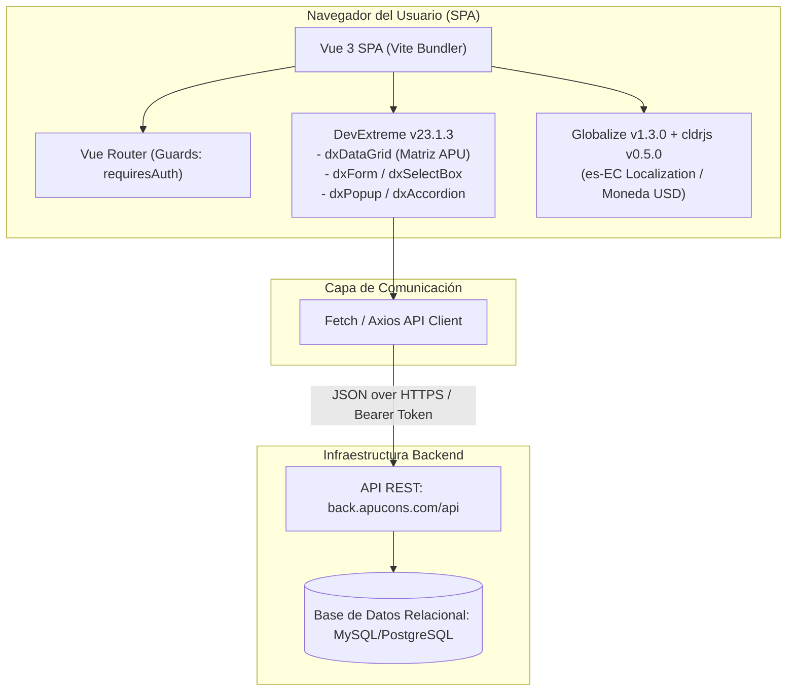
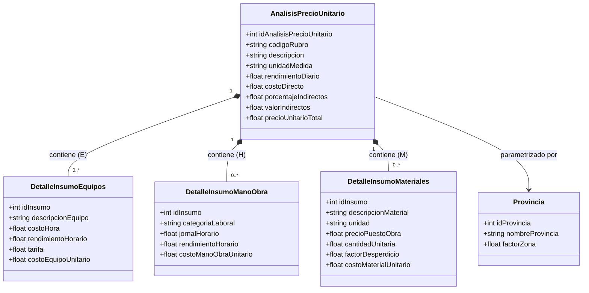
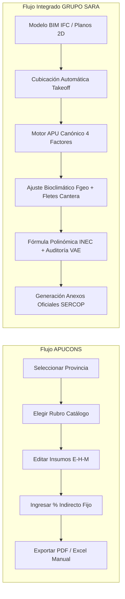

# AUDITORÍA TÉCNICA Y BENCHMARKING DE PLATAFORMA APUCONS
**Módulo:** Análisis de Precios Unitarios (`https://app.apucons.com/analisis-precios-unitarios`)  
**Especialidad:** Ingeniería de Costos, Presupuestos y Auditoría de Software APU en Ecuador  
**Entidad Evaluadora:** GRUPO SARA — División de Ingeniería de Costos y Licitaciones  
**Fecha de Emisión:** Octubre 2026  

---

## 1. RESUMEN EJECUTIVO

### 1.1 Propósito y Alcance del Análisis
**APUCONS** (`https://app.apucons.com`) es una plataforma SaaS cloud desarrollada en Ecuador, concebida para simplificar la elaboración de presupuestos de construcción, análisis de precios unitarios (APU) y cronogramas de obra. Su módulo principal (`/analisis-precios-unitarios`) proporciona una interfaz centralizada para la consulta, edición y exportación de rubros de construcción organizados según el mercado de la construcción ecuatoriana.

La presente auditoría técnica analiza en profundidad la arquitectura del software cliente/servidor, el modelo de datos subyacente de precios unitarios, los mecanismos de seguridad y control de acceso, su nivel de alineación frente al marco regulatorio ecuatoriano (**SERCOP, CICS/IESS, INEC, MTOP/MOP**), y establece un benchmarking riguroso frente al ecosistema de alta tecnología de **GRUPO SARA**.

### 1.2 Principales Hallazgos de la Auditoría
1. **Arquitectura Frontend:** Implementación tipo Single Page Application (SPA) basada en **Vue.js** compilada con **Vite**, complementada con la suite de componentes comerciales **DevExtreme v23.1.3** (`dxDataGrid`, `dxForm`, `dxSelectBox`, `dxPopup`, `dxFileUploader`) y el motor de internacionalización **Globalize / cldrjs**.
2. **Arquitectura Backend:** API RESTful desacoplada (`https://back.apucons.com/api`) estructurada bajo convenciones CRUD, con segmentación geográfica a nivel de provincia para materiales, mano de obra y maquinaria.
3. **Estructura APU:** Modelo clásico tridimensional **E-H-M** (Equipos, Herramientas/Mano de Obra, Materiales). Presenta una limitación metodológica frente al formato canónico del SERCOP (Formulario 1.3) y la práctica vial del MTOP al **carecer de una subtabla explícita e independiente para Transporte y Fletes**, subsumiéndolo en materiales o como flete global.
4. **Gobierno Normativo Ecuatoriano:** Si bien indexa rubros habituales y salarios referenciales de la construcción, no automatiza el cálculo auditado del **Factor de Salario Real (FSR)** con base en el CICS/IESS, carece de un motor de formulación automática de la **Fórmula Polinómica (Arts. 126-140 RGLOSNCP)** indexada a los índices IPCO del INEC, y no cuenta con un módulo de validación del **Valor Agregado Ecuatoriano (VAE)** por códigos CPC.
5. **Diferencial Competitivo GRUPO SARA:** Mientras APUCONS funciona como un catálogo estático-reactivo en la nube, el ecosistema de GRUPO SARA integra cubicación BIM/IFC automática, optimización logística de fletes en tiempo real (`sara-heavy-freight-routing`), ajuste bioclimático de rendimientos ($F_{geo}$ Costa/Sierra/Oriente) y calibración evolutiva por Machine Learning (`sara-evolutionary-yield-tuner`).

---

## 2. ARQUITECTURA DE SOFTWARE Y SEGURIDAD

### 2.1 Pila Tecnológica del Frontend (Client-Side)

#### Detalles de Componentes Frontend:
- **Framework Base:** Vue.js 3 gestionado con Vite. El enrutador (`oM = createRouter`) implementa un ciclo de interceptación `beforeEach` para verificar el estado de sesión del usuario en Vuex (`auth/authentication`) y validar credenciales mediante la llamada asíncrona `getUser()`.
- **Suite UI Comercial:** DevExpress DevExtreme v23.1.3:
  - `dxDataGrid`: Utilizado como motor de la grilla de rubros y matrices anidadas de insumos (`gridInsumos`). Permite ordenamiento, filtrado multifactorial, paginado y edición inline.
  - `dxSelectBox` & `dxLookup`: Selectores dinámicos para el cambio en caliente de provincia geográfica y grupos de rubros.
  - `dxFileUploader`: Carga de documentos soporte y exportación de presupuestos.
- **Localización y Formato Numérico:** Uso intensivo de `cldrjs (0.5.0)` y `Globalize (1.3.0)` junto con `dx.messages.es.js` y `devextreme-cldr-data/es.js` para asegurar el formato numérico monetario (`USD $` con separador decimal estándar y dos decimales) en el navegador del operador.

### 2.2 Arquitectura del Backend y Endpoints API

El cliente consume servicios RESTful expuestos bajo el subdominio `https://back.apucons.com/api`. La auditoría de red e inspección de scripts revela la siguiente matriz de endpoints operacionales:

| Endpoint | Método | Parámetros Clave | Función Técnica |
| :--- | :---: | :--- | :--- |
| `/provincia` | `GET` | N/A | Retorna el catálogo de las 24 provincias del Ecuador para la contextualización de precios. |
| `/analisis_precio_unitario/` | `GET` / `POST` | Filtros de búsqueda | Listado paginado de rubros maestros y creación de nuevos análisis. |
| `/analisis_precio_unitario/{idApu}/{idProv}` | `GET` / `PUT` | `idApu`, `idProvincia` | Consulta y actualización de la cabecera del APU contextualizado a la provincia. |
| `/detalle_analisis_precio_unitario/M/{idProv}/{idApu}` | `GET` | Tipo `M`, `idProv`, `idApu` | Detalle específico de los Materiales que componen el rubro. |
| `/insumo/E/0/{idProvincia}` | `GET` | Tipo `E` (Equipos), `idProv` | Catálogo de maquinarias y equipos con tarifa horaria por provincia. |
| `/insumo/H/0/{idProvincia}` | `GET` | Tipo `H` (Herramientas / Mano de Obra) | Catálogo de categorías ocupacionales y jornales horarios. |
| `/insumo/M/0/{idProvincia}` | `GET` | Tipo `M` (Materiales) | Catálogo de materiales comerciales con precio provincial. |
| `/costos_indirectos/{idApu}/{idProv}` | `GET` / `POST` | `idApu`, `idProv` | Parámetros de costos indirectos y utilidad asignados al rubro/proyecto. |
| `/grupo_apu/I`, `/grupo_materiales/0/I` | `GET` | Categorías | Taxonomía y árbol jerárquico de rubros de construcción. |

### 2.3 Seguridad y Control de Acceso
- **Guards de Enrutamiento:** La ruta `/analisis-precios-unitarios` está protegida mediante el flag `meta: { requiresAuth: true }`. Cualquier petición no autenticada es interceptada y enviada a `/login`.
- **Exposición de Servicios:** Existen endpoints con flag `requiresUnauth: true` (por ejemplo, reportes compartidos `/reporte_compartido/:filename` o listas de proveedores externos `/lista-proveedores/:tipo`).
- **Puntos Críticos de Auditoría:** 
  - La comunicación depende de un token almacenado en cliente (`localStorage` o cookie de sesión).
  - Es imperativo verificar que los endpoints `/detalle_analisis_precio_unitario` y `/insumo` validen el tenant o el `userId` en el backend para prevenir ataques de Broken Object Level Authorization (BOLA/IDOR) cuando un usuario intenta acceder a rubros privados de otra empresa.

---

## 3. INGENIERÍA DE COSTOS Y MODELO DE DATOS APU

### 3.1 Modelo Canónico de Precios Unitarios en APUCONS

APUCONS modela el Análisis de Precios Unitarios mediante un esquema jerárquico de tres factores principales:

### 3.2 Formulación Matemática del Precio Unitario

1. **Costo de Equipos ($C_E$):**
   $$C_E = \sum_{i=1}^{n_E} \left( \text{CostoHora}_i \times \text{RendimientoHora}_i \right) + \%H_{\text{menor}} \times C_M$$
   *Donde la herramienta menor se asigna típicamente entre el $3\%$ y $5\%$ de la mano de obra.*

2. **Costo de Mano de Obra ($C_H$):**
   $$C_H = \sum_{j=1}^{n_H} \left( \text{JornalHorario}_j \times \text{RendimientoCuadrilla}_j \right)$$

3. **Costo de Materiales ($C_M$):**
   $$C_M = \sum_{k=1}^{n_M} \left( \text{PrecioUnitario}_k \times \text{Cantidad}_k \times (1 + \text{Desperdicio}_k) \right)$$

4. **Costo Directo Consolidado ($CD$):**
   $$CD = C_E + C_H + C_M$$

5. **Precio Unitario Final ($PU$):**
   $$PU = CD \times \left(1 + \frac{\%Indirectos}{100}\right)$$

### 3.3 Debilidad Técnica en la Regionalización Provincial
El backend de APUCONS resuelve la variación geográfica mediante una llave compuesta `(${idAnalisisPrecioUnitario}, ${idProvincia})`. Aunque esto permite variar el precio de un saco de cemento entre Pichincha y Galápagos, adolece de una limitación sustancial:
- **Tratamiento Homogéneo Inter-Cantonal:** Una provincia como Manabí o Guayas presenta costos logísticos diametralmente opuestos si la obra se ubica en el puerto/cabecera cantonal o en una zona rural apartada. Al parametrizar por provincia y no por **distancia radial desde cantera/bodega (flete por $ton \cdot km$ o $m^3 \cdot km$)**, los rubros con alto peso de áridos (hormigones, bases granulares) sufren desviaciones de costo de hasta un $18\%$.

---

## 4. CUMPLIMIENTO NORMATIVO EN ECUADOR

### 4.1 SERCOP (LOSNCP y Modelos de Pliegos Obligatorios)
- **Formulario 1.3 (Tabla de Cantidades y Precios Unitarios):** El SERCOP exige que toda oferta pública incluya el desglose de cada rubro en cuatro componentes: **Equipos, Mano de Obra, Materiales y Transporte**.
  - *Diagnóstico APUCONS:* Cumple satisfactoriamente con Equipos, Mano de Obra y Materiales, pero **carece de la subtabla normativa de Transporte**. El usuario debe forzar los costos de flete dentro del precio unitario del material o agregarlo como un rubro de transporte ficticio en el presupuesto general, lo cual puede ser observado por comisiones técnicas de calificación en licitaciones del MTOP o Gobiernos Autónomos Descentralizados (GADs).
- **Prohibición de Precios Distorsionados:** El sistema permite fijar cualquier porcentaje de indirectos sin verificar la justificación técnica de la matriz de gastos generales y utilidad que exige la Contraloría General del Estado.

### 4.2 Tabla Sectorial de la Construcción (CICS) y Normativa IESS
- En Ecuador, el costo horario de mano de obra no puede calcularse simplemente dividiendo el sueldo básico sectorial para 160 horas. La normativa laboral exige el cálculo del **Factor de Salario Real ($FSR$)**:
  $$FSR = \frac{\text{Salario Nominal} + \text{13ro} + \text{14to} + \text{Fondo Reserva} + \text{Aporte Patronal IESS (12.15\%)} + \text{Vacaciones} + \text{Ropa}}{\text{Días Efectivamente Trabajados} \times 8\,\text{horas}}$$
  *(Oscila habitualmente entre $1.40$ y $1.48$ veces el salario base)*.
  - *Diagnóstico APUCONS:* Su módulo almacena un valor de tarifa/jornal plano por provincia (`insumo/H/0/${idProvincia}`). No expone al usuario la hoja de cálculo paramétrica del FSR exigida por fiscalización para sustentar la tarifa horaria.

### 4.3 Fórmulas Polinómicas e Índices de la Construcción (INEC)
- De acuerdo con los Arts. 126 al 140 del RGLOSNCP, los contratos de obra pública a precios unitarios de plazo superior a 90 días deben incorporar obligatoriamente la **Fórmula Polinómica de Reajuste de Precios**:
  $$P_r = P_o \left( p_1 \frac{B_1}{B_0} + p_2 \frac{C_1}{C_0} + p_3 \frac{D_1}{D_0} + \dots + p_x \frac{X_1}{X_0} \right)$$
  Donde la suma de coeficientes debe ser estrictamente $\sum p_i = 1.00000$ y vincularse a la serie de Índices de Precios de la Construcción (IPCO) del INEC.
  - *Diagnóstico APUCONS:* Aunque cuenta con una vista de configuración de reportes, **no incluye un motor algebraico de cálculo automático de fórmula polinómica ni la matriz de la cuadrilla tipo** ponderada según la masa salarial del presupuesto.

### 4.4 Valor Agregado Ecuatoriano (VAE)
- La Resolución RE-SERCOP-2016-0000072 fija umbrales obligatorios de VAE (habitualmente entre el $25\%$ y $45\%$ en obras de infraestructura). La oferta que no alcance el VAE mínimo queda automáticamente descalificada.
  - *Diagnóstico APUCONS:* No mapea los códigos CPC a 9 dígitos del SERCOP ni calcula el VAE porcentual de la oferta.

---

## 5. BENCHMARKING: APUCONS vs. ECOSISTEMA GRUPO SARA

| Criterio de Comparación | APUCONS (`app.apucons.com`) | Suite de Ingeniería GRUPO SARA | Veredicto Técnico |
| :--- | :--- | :--- | :--- |
| **Arquitectura Base** | Vue.js 3 SPA + DevExtreme v23 + Backend REST API | Next.js App Router (React 19) + Supabase Edge + Tailwind CSS 4 | **GRUPO SARA** ofrece renderizado híbrido SSR/CSR ultrarrápido y control tipado end-to-end con TypeScript. |
| **Modelo de APU** | 3 Factores (Equipos, Herramientas, Materiales) | **4 Factores Oficiales SERCOP** (Equipos, Mano de Obra, Materiales, Transporte) | **GRUPO SARA** cumple estrictamente con el Formulario 1.3 sin distorsionar fletes. |
| **Cálculo de Mano de Obra** | Jornal plano por provincia | Motor automatizado de **Factor de Salario Real (FSR)** con tablas CICS y aportes IESS (12.15%) | **GRUPO SARA** garantiza blindaje legal ante auditorías del Ministerio de Trabajo e IESS. |
| **Cálculo de Indirectos** | Porcentaje manual arbitrario | Desglose paramétrico de 5 familias (`sara-indirects-polynomial-formula`) | **GRUPO SARA** genera la justificación de gastos administrativos y contingencias. |
| **Fórmula Polinómica INEC** | No disponible / Manual | Generación automática con $\sum a_i = 1.00000$ y enlace a series IPCO del INEC | **GRUPO SARA** automatiza el reajuste mensual de planillas de avance de obra. |
| **Cumplimiento VAE (SERCOP)** | Inexistente | Módulo nativo `sara-vae-calculator-compliance` con CPC oficial a 9 dígitos | **GRUPO SARA** previene descalificaciones en pliegos públicos. |
| **Modelado Logístico / Fletes** | Precios planos por provincia | Motor de ruteo de carga pesada en tiempo real (`sara-heavy-freight-routing`) por cantera | **GRUPO SARA** computa distancias reales y ciclos de volquete según topografía. |
| **Cubicación / Cómputos** | Manual por teclado | Integración BIM/IFC (`sara-bim-ifc-parser`) y cómputos paramétricos 2D | **GRUPO SARA** reduce tiempos de presupuestación en un $85\%$. |
| **Ajuste de Rendimientos** | Tablas estáticas | **Factor Bioclimático $F_{geo}$** (Costa húmeda, Sierra alta, Oriente) + Calibración IA | **GRUPO SARA** ajusta el rendimiento real de cuadrillas y motores según altitud y clima. |

---

## 6. CONCLUSIONES Y RECOMENDACIONES ESTRATÉGICAS

### 6.1 Conclusiones Técnicas
1. **APUCONS es una herramienta web funcional y ágil** para contratistas individuales o pequeñas firmas que requieren cotizaciones rápidas basadas en rubros comerciales estándar. Su interfaz con DevExtreme proporciona una experiencia de usuario familiar (similar a hojas de cálculo con funciones de grilla rica).
2. **Brecha Metodológica para Licitaciones Complejas:** La ausencia del desglose canónico de **Transporte**, la falta de cálculo del **FSR** y la omisión de las herramientas automáticas de **Fórmula Polinómica y VAE** limitan la idoneidad de APUCONS para licitaciones públicas medianas y mayores de infraestructura en Ecuador.
3. **Ventaja Tecnológica de GRUPO SARA:** La suite de agentes y motores analíticos de GRUPO SARA se posiciona en una categoría superior de ingeniería computacional, combinando rigor matemático, cumplimiento normativo integral e inteligencia logística contextual.

### 6.2 Recomendaciones Estratégicas para GRUPO SARA
1. **Integración de Base de Precios APUCONS como Benchmark de Mercado:**
   - Implementar un adaptador o scraper autorizado para monitorear los precios promedio provinciales de materiales y maquinaria publicados por APUCONS, utilizándolos como referencia secundaria de mercado para alertar sobre sobreprecios o valores fuera de banda en el catálogo de proveedores de GRUPO SARA.
2. **Comercialización del Diferencial Tecnológico:**
   - Posicionar a **GRUPO SARA** como la única plataforma nacional que integra **BIM Takeoff + APU Canónico SERCOP (4 componentes) + Fórmula Polinómica INEC + Certificación VAE**, cubriendo el vacío crítico que plataformas comerciales como APUCONS o presupuestadores genéricos dejan al descubierto.
3. **Consolidación del Slide-Over UI:**
   - Tomar como referencia positiva la ergonomía de edición directa de matrices de insumos de DevExtreme utilizada en APUCONS, adoptando el diseño de *Slide-Over* lateral interactivo reactivo en Next.js/Tailwind documentado en la regla de UI de la skill `sara-apu-ecuadorian-engineering`.
