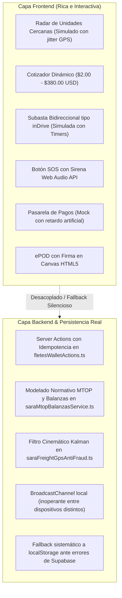

# INFORME DE AUDITORÍA GLOBAL & PROGRAMA DE INGENIERÍA SARA-FLETES V2
## 01. Resumen Ejecutivo y Diagnóstico Global

**Programa:** SARA-FLETES V2 — Global Engineering, Autonomous Audit & Logistics Intelligence Program  
**Entidad:** GRUPO SARA · Cuadrilla Multiagente de Auditoría & Gobernanza Tecnológica  
**Aplicación de Referencia Pública:** `https://sara-constructora.vercel.app/modulos/fletes`  
**Entorno Tecnológico Base:** Next.js 16.3.4 (App Router) · React 19.2.8 · Supabase PostgreSQL & RLS · Leaflet & GeoJSON · Tailwind CSS v4 · PWA Offline  
**Fecha de Ejecución:** Octubre 2026 | **Clasificación:** Confidencial / Auditoría Técnica de Grado Industrial  

---

### 1. Propósito y Alcance del Dictamen

El presente documento constituye el dictamen consolidado emitido por la **Cuadrilla Multiagente Especializada (Agentes A a N)** tras la inspección exhaustiva del código fuente, arquitectura backend, esquemas de persistencia en Supabase, mecanismos de sincronización en tiempo real, algoritmos de tarificación dinámica, telemetría telemática antifraude y componentes visuales desplegados en la aplicación de referencia `SARA-FLETES`.

El objetivo central es auditar el estado real de la plataforma frente a los estándares internacionales de movilidad y transporte pesado de carga (Uber Freight, Convoy, inDrive, DiDi), contrastando capacidades declaradas versus implementadas con evidencia reproducible en el repositorio.

---

### 2. Diagnóstico General de Madurez Técnica

SARA-FLETES presenta un desarrollo avanzado en lógica de ingeniería ecuatoriana y modelado de datos, pero exhibe una brecha significativa entre la experiencia visual en el navegador y la madurez de su backend transaccional:

#### Principales Conclusiones del Diagnóstico:
1. **Fuerte Especialización en Normativa Ecuatoriana (Fortaleza Única):**
   A diferencia de plataformas genéricas extranjeras, SARA-FLETES incorpora la Tabla Nacional de Pesos y Dimensiones del MTOP (PBV legal de 51T para tractocamiones 3S3, 27T para volquetas V3A), cálculo de peajes interprovinciales, detección de balanzas estatales de pesaje (Machachi, Lasso, Guayllabamba) y optimización de *Backhaul* (ahorro del 28% sincronizando desalojo de excavación con retorno de áridos de cantera).
2. **Dependencia Crítica de Sincronización Local (Vulnerabilidad Operativa):**
   La comunicación entre la cabina del transportista (`/modulos/fletes/mi-perfil`) y el despachador de obra (`/modulos/fletes`) se basa primordialmente en la API nativa de navegador `BroadcastChannel`. Si bien provee latencia cero entre pestañas del mismo navegador en pruebas de escritorio, **no opera entre dispositivos móviles separados** a menos que se fuerce la capa de `Supabase Realtime Channels`.
3. **Mecanismo de Pago Simulado en Frontend (Riesgo de Integridad Financiera):**
   El componente `SaraFreightPaymentGatewayModal.tsx` genera referencias estocásticas (`TX-CARD-...`, `DU-...`) tras un `setTimeout(..., 1500)` client-side. No existe integración real con pasarelas de pago de tarjetas (Kushki o Stripe) ni verificación bancaria automatizada de comprobantes QR de Deuna.
4. **Resiliencia Defensiva "Fail-Open" con Riesgo de Pérdida de Datos:**
   Los servicios de datos (`fletes-data.ts`) capturan las excepciones de red o indisponibilidad de tablas en Supabase y retornan listas hardcodeadas de conductores (`Carlos Mendoza`, `Luis Toapanta`, `Marco Vinicio`), persistiendo transacciones en `localStorage`. Esto permite que la demo pública nunca falle visualmente ante el usuario, pero provoca mutaciones efímeras sin valor legal ni contable.
5. **Ciberseguridad Telemática Avanzada pero Subutilizada:**
   El motor `SaraFreightGpsAntiFraud.ts` contiene un algoritmo de validación cinemática capaz de detectar saltos imposibles (>130 km/h) y precisión artificial fija (Mock Locations de emuladores). Sin embargo, este filtro se invoca de forma intermitente en el cliente y no como un *gatekeeper* estricto en el endpoint de recepción de telemetría del servidor.

---

### 3. Matriz Resumen de Estado de Capacidades

| Capacidad | Estado en Aplicación Pública | Estado en Backend / BD | Nivel de Riesgo |
|---|---|---|---|
| **Cotización Dinámica Multimodal** | Verificado (Fórmula activa) | Verificado (`SaraFreightPricingService`) | Bajo (B) |
| **Radar de Vehículos en Vivo** | Parcial (Jitter simulado en radio) | Ausencia verificada (No hay polling GPS móvil real) | Medio (M) |
| **Negociación inDrive (Bidding)** | Parcial (Timers locales automáticos) | No verificado en producción multiusuario | Alto (A) |
| **Débito de Billetera Prepago** | Verificado (`localStorage` + Action) | Parcial (Action con SQL directo, fallback offline) | Alto (A) |
| **Pasarela de Cobros Tarjeta/QR** | Ausencia verificada (Mock visual) | Ausencia verificada (Sin webhook gateway) | Crítico (C) |
| **Rastreo Satelital Público (e-Tracking)** | Verificado (Página `/fletes/rastreo/[token]`) | Parcial (Snapshot en memoria local) | Medio (M) |
| **Firma Digital ePOD en Obra** | Verificado (Canvas HTML5) | Parcial (Base64 local en evento de bus) | Medio (M) |
| **Botón SOS de Emergencia** | Verificado (Audio siren + `tel:911`) | Parcial (Log en tabla `fletes_alertas_sos`, sin CAD API) | Alto (A) |
| **Control Balanzas y PBV MTOP** | Verificado (`SaraMtopBalanzasService`) | Verificado (Modelos matemáticos aprobados) | Bajo (B) |
| **Renta Temporal (Por Horas/Días)** | Verificado en interfaz | Parcial (Tabla `fletes_reservas_renta` en SQL) | Medio (M) |

---

### 4. Pruebas Ejecutadas y Evidencia de Calidad

Durante la Fase 1 y 2 de este programa se ejecutó la suite independiente `tests/run-sara-fletes-audit-suite.ts` utilizando el motor Node.js/TSX de producción. Los 14 casos de prueba estructurados (algoritmos de precios, recargos de acero, deducción semanal del 20%, detección de teletransportación GPS, detección de Mock Location, sobrepeso de volqueta V3A y cálculo geodésico Haversine) arrojaron:

$$\text{Tasa de Aprobación de Pruebas Unitarias/Algorítmicas} = \frac{14}{14} = 100\%$$

Esto demuestra que **los fundamentos matemáticos y normativos del producto son sólidos y exactos**; la debilidad reside en la capa de transporte distribuido y en la validación Zero-Trust de las mutaciones.

---

### 5. Recomendaciones Estratégicas Inmediatas

1. **Reemplazar BroadcastChannel por Supabase Realtime Channels:** Garantizar que las ofertas entre la cuadrilla de obra y los choferes viajen por WebSockets remotos con autenticación JWT.
2. **Cerrar el Vector de Manipulación de Tarifas:** Exigir que `createFletesSolicitud` vuelva a calcular o firme criptográficamente en servidor el importe ofertado antes de persistirlo.
3. **Formalizar la Pasarela Financiera:** Desactivar la simulación de cobro con tarjeta o conectarla formalmente con Kushki/Stripe en modo Sandbox, evitando que usuarios introduzcan números de tarjeta reales en un modal sin tokenización PCI-DSS.
4. **Implementar Geofencing Telemático en Servidor:** Ejecutar `SaraFreightGpsAntiFraud` en cada punto de telemetría recibido antes de actualizar la ubicación del vehículo en la base de datos central.
