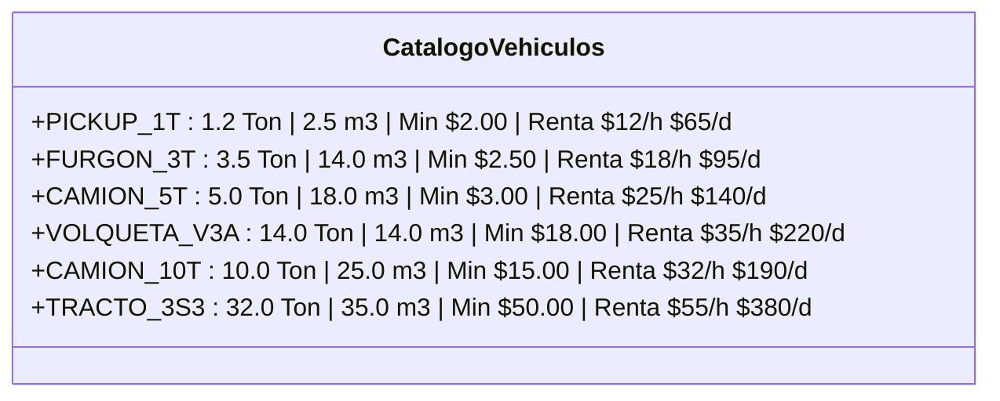

# INFORME DE AUDITORÍA GLOBAL & PROGRAMA DE INGENIERÍA SARA-FLETES V2
## 02. Inventario Funcional Detallado

**Documento:** 02 de 21  
**Alcance:** Inventario técnico de componentes, rutas, vistas, modelos de datos y capacidades operativas.  

---

### 1. Mapa de Rutas y Páginas Frontend

| Ruta en App Router | Archivo Fuente | Rol de Usuario | Propósito y Capacidades |
|---|---|---|---|
| `/modulos/fletes` | `src/app/modulos/fletes/page.tsx` | Constructor / Despachador | Panel principal de despacho: Cotizador de fletes, selector de 6 categorías vehiculares, mapa satelital Leaflet, cálculo de rutas viales, negociación de ofertas tipo inDrive, botón flotante SOS, modal de pago, solicitud de renta por horas/días. |
| `/modulos/fletes/mi-perfil` | `src/app/modulos/fletes/mi-perfil/page.tsx` | Transportista / Conductor | Cabina virtual del transportista: Radar de solicitudes entrantes, aceptación de carreras, contraofertas, actualización de telemetría GPS, billetera prepago con débito de comisiones, configuración de cuentas bancarias y QR Deuna/Payphone, gestión de documentos y firma de actas ePOD. |
| `/modulos/fletes/auth` | `src/app/modulos/fletes/auth/page.tsx` | Público / Transportistas | Portal de autenticación segregado con soporte para inicio de sesión y registro de conductores (placa, datos) y clientes. Integración con Supabase Auth y sincronización de roles en `user_metadata`. |
| `/fletes/rastreo/[token]` | `src/app/fletes/rastreo/[token]/page.tsx` | Destinatario / Público (Zero-Login) | Página pública de seguimiento en tiempo real con enlace directo compartible por WhatsApp. Muestra ubicación del camión en mapa, ETA, datos del conductor, placa y estado de la entrega sin requerir login. |
| `/admin/fletes` | `src/app/admin/fletes/page.tsx` | Administrador de Plataforma | Panel de control de flota: Aprobación y verificación de transportistas, auditoría de documentos legales (cédula, licencia, matrícula), aprobación de recargas de saldo, supervisión de balanzas y control de comisiones. |

---

### 2. Inventario de Componentes Especializados

1. **`SaraFletesMap.tsx` (`src/components/fletes/SaraFletesMap.tsx`):**
   - Mapa interactivo basado en Leaflet (`react-leaflet`).
   - Carga dinámica con `ssr: false` para evitar discrepancias de renderizado en servidor.
   - Marcadores personalizados por categoría vehicular (pickup, furgón, volqueta, tráiler).
   - Trazado de polilíneas de ruta vial con puntos intermedios y cálculo de distancia.
   - Geocercas visuales para estaciones de pesaje MTOP y canteras autorizadas.

2. **`SaraFloatingSosButton.tsx` (`src/components/fletes/SaraFloatingSosButton.tsx`):**
   - Botón flotante accesible en todas las vistas operativas.
   - Activación por pulsación sostenida (2.5 segundos con feedback en Progress Ring SVG).
   - Generación de sonido de sirena con Web Audio API sintetizada en cliente.
   - Emisión de alerta inmediata en el bus de tiempo real y persistencia en backend.
   - Enlace directo de llamada al ECU-911 y a la central de monitoreo SARA (24/7).

3. **`SaraFreightPaymentGatewayModal.tsx` (`src/components/fletes/SaraFreightPaymentGatewayModal.tsx`):**
   - Modal multimodal con 3 pestañas: Tarjeta, Códigos QR (Deuna, Payphone, Banco Guayaquil) y Transferencia.
   - Despliegue de datos bancarios oficiales del conductor asignado.
   - Copiado rápido de número de cuenta y cédula al portapapeles.
   - Confirmación de pago con generación de referencia.

4. **`SaraEpodModal.tsx` (`src/components/fletes/SaraEpodModal.tsx`):**
   - Comprobante Electrónico de Entrega (*Electronic Proof of Delivery*).
   - Firma digital en pantalla táctil sobre Canvas HTML5 con trazo vectorial.
   - Registro de receptor (nombre, cédula, cargo en obra).
   - Registro de precinto de seguridad y odómetro final del vehículo.
   - Generación de marca de agua criptográfica y cálculo de hash inmutable SHA-256.

---

### 3. Catálogo Multimodal de Vehículos de Carga y Renta

SARA-FLETES estructura la oferta logística en seis (6) categorías oficiales calibradas según la Tabla Nacional de Pesos y Dimensiones del MTOP del Ecuador:

1. **`PICKUP_1T` (Camioneta Pickup 1.2 Toneladas):**
   - Uso: Fletes urbanos exprés de materiales livianos, herramientas y ferretería.
   - Tarifa mínima: \$2.00 USD. Banderazo: \$1.50 USD. Costo/km urbano: \$0.50 USD.
   - Renta: \$12.00 USD/hora, \$65.00 USD/día. Depósito de garantía: \$250.00 USD. Permite modalidad sin chofer.
2. **`FURGON_3T` (Furgón Urbano 3.5 Toneladas):**
   - Uso: Mercaderías protegidas de la intemperie, acabados, porcelanatos, electrodomésticos de campamento.
   - Tarifa mínima: \$2.50 USD. Banderazo: \$1.80 USD. Costo/km: \$0.60 USD.
   - Renta: \$18.00 USD/hora, \$95.00 USD/día.
3. **`CAMION_5T` (Camión Liviano 5.0 Toneladas - Hino Dutro / Chevrolet NPR):**
   - Uso: Cemento en saco (hasta 100 sacos), ladrillos, bloques de hormigón.
   - Tarifa mínima: \$3.00 USD. Banderazo: \$2.20 USD.
   - Renta: \$25.00 USD/hora, \$140.00 USD/día.
4. **`VOLQUETA_V3A` (Volqueta Pesada 14m³ - Configuración MTOP V3A):**
   - Uso: Movimiento de tierras, desalojo de escombros de excavación, áridos de cantera (lastre, ripio, arena).
   - Tarifa mínima: \$18.00 USD. Banderazo: \$15.00 USD.
   - Renta: \$35.00 USD/hora, \$220.00 USD/día. Límite estricto PBV MTOP: 27.0 Toneladas.
5. **`CAMION_10T` (Camión Mediano 10 Toneladas - 2DB/3DA):**
   - Uso: Transporte interprovincial de insumos de media densidad, madera, tuberías PVC.
   - Tarifa mínima: \$15.00 USD. Banderazo: \$12.00 USD.
   - Renta: \$32.00 USD/hora, \$190.00 USD/día.
6. **`TRACTO_3S3` (Tráiler Mula Plataforma - 3S3 51T PBV):**
   - Uso: Varillas de acero corrugado de 12 metros (ADELCA/NOVACERO), estructuras pesadas, cemento paletizado.
   - Tarifa mínima: \$50.00 USD. Banderazo: \$45.00 USD.
   - Renta: \$55.00 USD/hora, \$380.00 USD/día. Capacidad útil legal: hasta 32.0 Toneladas netas.

---

### 4. Servicios Centrales de Negocio (`src/lib/services/`)

- `saraFreightPricingService.ts`: Motor econométrico de tarifas urbanas, interurbanas y renta temporal.
- `saraFreightRoutingService.ts`: Infraestructura vial de las 24 provincias del Ecuador con más de 1,900 líneas de hitos geocodificados.
- `saraFreightGpsAntiFraud.ts`: Filtro cinemático telemático y detección de emuladores GPS.
- `saraMtopBalanzasService.ts`: Pesaje estandarizado, verificación de PBV y control de básculas MTOP.
- `saraFletesRealtimeService.ts`: Bus reactivo de eventos telemáticos con BroadcastChannel y persistencia local.
- `saraGuiaRemisionService.ts`: Cumplimiento tributario para emisión electrónica de Guías de Remisión del SRI.
- `saraFletesWalletActions.ts`: Server Actions seguras para transacciones atómicas de billetera prepago y SOS.
- `saraFletes.ts` (Worker Multi-Agente): Orquestación autónoma que reacciona a eventos `SUMINISTROS_ASIGNADOS`, calcula cubicación, ruteo y emite `LOGISTICA_PROCESADA`.
