# INFORME DE AUDITORÍA GLOBAL & PROGRAMA DE INGENIERÍA SARA-FLETES V2
## 03. Arquitectura del Sistema, Flujos de Datos y Dependencias

**Documento:** 03 de 21  
**Alcance:** Diagramas de arquitectura, interconexión de servicios, topología de despliegue y análisis de acoplamiento.  

---

### 1. Diagrama de Arquitectura Global de SARA-FLETES

```mermaid
flowchart TB
    subgraph Client_Layer["CAPA CLIENTE (Next.js 16 App Router & PWA Offline)"]
        DESP["Despachador de Fletes\n(/modulos/fletes)"]
        CAB["Cabina Transportista\n(/modulos/fletes/mi-perfil)"]
        ADM["Admin de Flota\n(/admin/fletes)"]
        PUB["Rastreo Satelital Público\n(/fletes/rastreo/[token])"]
    end

    subgraph Sync_Bus["BUS REACTIVO & SINCRONIZACIÓN"]
        BC["BroadcastChannel ('sara_fletes_bus')\nLatencia Cero en Mismo Navegador"]
        LS["LocalStorage Fallback\n('sara_fletes_rt_*')"]
        SRT["Supabase Realtime\n(Canales WebSocket - En Fase de Integración)"]
    end

    subgraph Compute_Layer["CAPA DE CÓMPUTO & LOGISTICA (Next.js Server & Workers)"]
        PRICING["SaraFreightPricingService\n(Tarificación Urbana/Interurbana/Renta)"]
        ROUTING["SaraFreightRoutingService\n(Hitos Nacionales & Ruteo Haversine)"]
        ANTIFRAUD["SaraFreightGpsAntiFraud\n(Filtro Cinemático Kalman)"]
        MTOP["SaraMtopBalanzasService\n(PBV 51T/27T & Básculas)"]
        WORKER["SaraFletesAgent (Worker)\n(Cubicación, Backhaul 28% & EventBus)"]
        ACTIONS["Server Actions\n(saraFletesWalletActions.ts)"]
    end

    subgraph Data_Layer["CAPA DE PERSISTENCIA (Supabase PostgreSQL / Zero-Trust)"]
        T_COND["fletes_conductores\n(Billetera, Placa, Perfil)"]
        T_SOL["fletes_solicitudes\n(Origen, Destino, Estado, PIN)"]
        T_VEH["fletes_vehiculos\n(Flota Multimodal & Renta)"]
        T_RES["fletes_reservas_renta\n(Horas/Días, Depósitos)"]
        T_TX["fletes_billetera_transacciones\n(Asientos Inmutables ACID)"]
        T_SOS["fletes_alertas_sos\n(Telemetría de Emergencia)"]
    end

    DESP <--> BC
    CAB <--> BC
    BC <--> LS
    CAB -.-> SRT
    DESP -.-> SRT

    DESP --> PRICING
    DESP --> ROUTING
    DESP --> ACTIONS
    CAB --> ANTIFRAUD
    CAB --> ACTIONS
    ADM --> ACTIONS

    ACTIONS --> T_COND
    ACTIONS --> T_TX
    ACTIONS --> T_SOS
    DESP --> T_SOL
    CAB --> T_SOL
    DESP --> T_RES

    WORKER <--> MTOP
    WORKER <--> PRICING
```

---

### 2. Ciclo de Vida y Flujo de una Solicitud de Flete

1. **Definición de Carga y Origen/Destino:**
   - El despachador ingresa los puntos en `src/app/modulos/fletes/page.tsx`.
   - `SaraFreightRoutingService` geocodifica la ubicación utilizando el diccionario de hitos del Ecuador o el API de geolocalización satelital.
   - `SaraFreightPricingService.calcularTarifa()` calcula la distancia ($D$), evalúa si es local ($D \le 5\,\text{km}$) o interurbano ($D > 5\,\text{km}$ con sinuosidad vial de 1.25 y peajes), y genera la tarifa de referencia y el rango de negociación inDrive ($[-15\%, +30\%]$).
2. **Emisión de la Solicitud:**
   - Se invoca `createFletesSolicitud()` en `src/lib/fletes-data.ts`, persistiendo en `fletes_solicitudes` y generando un PIN criptográfico de acceso de 4 dígitos.
   - Se emite el evento `NUEVA_SOLICITUD_FLETE` en `SaraFletesRealtimeService`.
3. **Recepción y Negociación de Ofertas (Subasta Bidireccional):**
   - La cabina del transportista (`src/app/modulos/fletes/mi-perfil/page.tsx`) recibe la solicitud en su radar.
   - Si no hay transportistas reales activos en la misma sesión, el despachador ejecuta un motor de simulación local basado en `setTimeout()` que propone 3 ofertas de choferes con variaciones de tarifa y tiempos de llegada (ETA).
   - El cliente acepta o contraoferta.
4. **Asignación y Verificación de Saldo de Billetera:**
   - Al aceptar una oferta, el sistema calcula la comisión de la plataforma (Plan Básico 10%, Estándar 20%, VIP 30%).
   - Se invoca `debitDriverCommissionAction` en `src/app/actions/saraFletesWalletActions.ts`, la cual efectúa una deducción atómica en `fletes_conductores` con clave de idempotencia única para prevenir dobles cobros por intermitencia celular.
5. **Tránsito y Telemetría en Vivo:**
   - El transportista activa la navegación. Se genera un `tokenRastreo` único de 16 caracteres.
   - El cliente puede compartir el enlace `/fletes/rastreo/[token]` a contratistas y bodegueros de obra.
6. **Entrega y Cierre con Acta Electrónica ePOD:**
   - En el punto de descarga, el receptor firma en pantalla sobre `SaraEpodModal`.
   - Se registran odómetro, precinto y conformidad.
   - Se emite `EPOD_CONFIRMADO`, cerrando el flete e impactando el historial contable.

---

### 3. Evaluación de Acoplamiento y Dependencias

- **Frontend Monolítico en Páginas de Despacho y Perfil:**
  `src/app/modulos/fletes/page.tsx` posee 2,955 líneas y `src/app/modulos/fletes/mi-perfil/page.tsx` posee 2,770 líneas. Ambos componentes integran estado de UI, ruteo geográfico, gestión de audio de sirenas, dibujo en canvas, manipulación de storage y llamadas directas a Supabase.
  - *Impacto:* Dificulta el testing unitario de componentes visuales aislados e incrementa el costo de mantenimiento.
- **Doble Bus de Datos (Local vs Remoto):**
  Existe una dualidad entre `SaraFletesRealtimeService` (basado en BroadcastChannel local) y las funciones de Supabase (`createSupabaseBrowserClient`). Si Supabase no responde o las tablas no están creadas en la instancia remota, el sistema cae silenciosamente en el bus local.
  - *Riesgo:* Falsa sensación de sincronización cuando se prueba en una sola máquina en dos pestañas, fallando al pasar a dos dispositivos celulares reales en obra.
