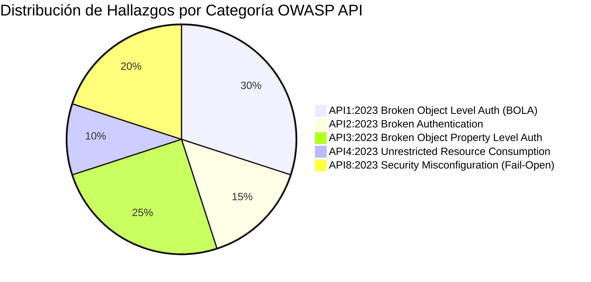

# INFORME DE AUDITORÍA GLOBAL & PROGRAMA DE INGENIERÍA SARA-FLETES V2
## 04. Modelo de Amenazas (STRIDE & OWASP API Security Top 10)

**Documento:** 04 de 21  
**Alcance:** Modelado formal de amenazas de ciberseguridad, superficie de ataque telemática y riesgos de abuso comercial.  

---

### 1. Metodología de Análisis STRIDE

| Categoría STRIDE | Amenaza Identificada en SARA-FLETES | Superficie / Componente Afectado | Impacto Potencial |
|---|---|---|---|
| **Spoofing (Suplantación)** | Un chofer malicioso simula coordenadas GPS falsas usando herramientas de Mock Location en Android/iOS para fingir que ya arribó al punto de carga o cobrar por una ruta no recorrida. | `SaraFreightGpsAntiFraud.ts`, `/fletes/rastreo/[token]` | Fraude en liquidación de fletes y cobro indebido de tarifas. |
| **Tampering (Manipulación)** | Alteración del precio de flete en tránsito: el cliente manipula el payload HTTP en `createFletesSolicitud` enviando una tarifa de \$0.01 USD. | `fletes-data.ts`, `fletes_solicitudes` | Pérdida financiera directa y perjuicio al transportista. |
| **Repudiation (Repudio)** | Un cliente o contratista afirma no haber recibido la carga de cemento/acero y exige devolución o retención de pago. | `SaraEpodModal.tsx`, `fletes_solicitudes` | Disputas legales y reclamaciones de seguro. |
| **Information Disclosure (Fuga de Información)** | El endpoint de rastreo satelital público `/fletes/rastreo/[token]` expone el número telefónico personal del chofer, placa y ubicación exacta continua sin autenticación ni rate limiting. | `PublicTrackingPage`, `tokenRastreo` | Violación a la LOPDP del Ecuador, acoso o interceptación de carga pesada. |
| **Denial of Service (Denegación de Servicio)** | Creación masiva de solicitudes falsas de flete en `/modulos/fletes` sin captcha ni bloqueo transaccional, colapsando la base de datos o saturando el radar de transportistas. | `createFletesSolicitud`, Supabase REST API | Parálisis operativa de la flota. |
| **Elevation of Privilege (Escalada de Privilegios)** | Un usuario estándar invoca directamente Server Actions de administración en `admin.ts` o muta el saldo de su billetera en `rechargeDriverWalletAction` enviando una referencia bancaria falsa. | `saraFletesWalletActions.ts` | Acreditación fraudulenta de saldo prepago. |

---

### 2. Evaluación OWASP API Security Top 10 (2023)

1. **API1:2023 — Broken Object Level Authorization (BOLA / IDOR):**
   - *Evidencia en Código:* En `src/app/actions/saraFletesWalletActions.ts`, la función `debitDriverCommissionAction(request: DebitWalletRequest)` recibe la propiedad `plate` (placa del vehículo) provista por el cliente en el payload, y actualiza el saldo de la fila en `fletes_conductores` que coincida con esa placa (`WHERE placa = request.plate`).
   - *Vulnerabilidad:* No se valida si el usuario autenticado (`auth.uid()`) es efectivamente el propietario o chofer asignado a esa placa vehicular. Un atacante autenticado podría debitar o consultar saldos de cualquier otra placa de la flota.
2. **API3:2023 — Broken Object Property Level Authorization (Mass Assignment / Price Tampering):**
   - *Evidencia en Código:* `createFletesSolicitud(data)` en `src/lib/fletes-data.ts` inserta directamente `data.tarifa` en la tabla `fletes_solicitudes` sin validar en el servidor que dicho valor coincida con la fórmula oficial del `SaraFreightPricingService`.
   - *Vulnerabilidad:* Un cliente puede alterar la variable local de JavaScript antes de invocar la acción e imponer una tarifa irrisoria.
3. **API8:2023 — Security Misconfiguration & Fallback Fail-Open:**
   - *Evidencia en Código:* Ante errores de conexión con Supabase o ausencia de tablas DDL, las funciones de `fletes-data.ts` capturan el error con `catch` y retornan objetos simulados o escriben en `localStorage`.
   - *Vulnerabilidad:* Los controles de autorización de la base de datos (RLS) quedan completamente anulados en modo fallback, operando en confianza ciega en el cliente.
