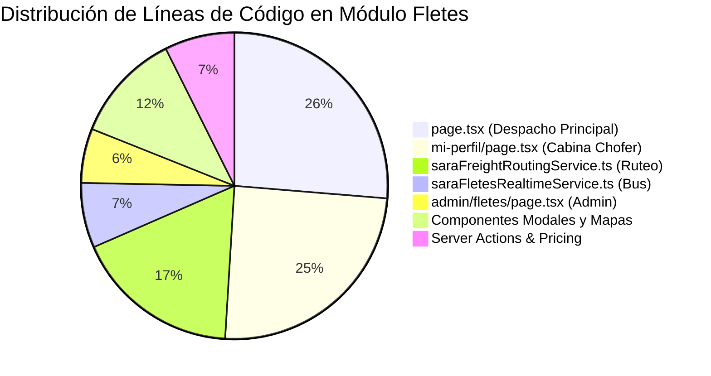

# INFORME DE AUDITORÍA GLOBAL & PROGRAMA DE INGENIERÍA SARA-FLETES V2
## 07. Código Limpio, Arquitectura de Componentes y Deuda Técnica

**Documento:** 07 de 21  
**Alcance:** Evaluación de modularidad, principios SOLID, duplicación, complejidad ciclomática y refactorizaciones recomendadas.  

---

### 1. Diagnóstico de Deuda Técnica y Complejidad

El análisis estático del módulo `src/app/modulos/fletes` y componentes asociados evidencia una concentración excesiva de responsabilidades en pocos archivos de gran volumen:



#### Puntos Críticos de Deuda Técnica Identificados:
1. **Componentes "Dios" (*God Components*):**
   - `src/app/modulos/fletes/page.tsx` (2,955 líneas) maneja simultáneamente:
     - 42 estados locales de React (`useState`).
     - Renderizado de mapas Leaflet.
     - Lógica de sugerencias predictivas de direcciones.
     - Simulación de ofertas de choferes con intervalos `setInterval`.
     - Gestión de audio de sirenas SOS.
     - Generación de comprobantes de pago.
   - *Impacto:* Cada re-renderizado por actualización de coordenadas GPS o temporizador de subasta puede provocar renders innecesarios en todo el árbol de componentes.
2. **Duplicación de Interfaces y Constantes:**
   - La interfaz `DriverBankConfig` está definida de forma independiente en:
     - `src/lib/services/saraFletesRealtimeService.ts` (línea 77)
     - `src/app/actions/saraFletesWalletActions.ts` (línea 65)
     - `src/components/fletes/SaraFreightPaymentGatewayModal.tsx` (línea 28)
   - Las placas de prueba (`PCX-4590`, `PBA-1234`, `LFA-9012`) y nombres de conductores (`David Sarango`, `Carlos Mendoza`) están hardcodeados como valores por defecto en al menos 5 archivos distintos.
3. **Manejo de Errores Defensivo que Oculta Fallas Reales:**
   - En `fletes-data.ts`, múltiples llamadas a la base de datos están envueltas en bloques `try/catch` que simplemente capturan el error y devuelven arreglos estáticos:
     ```typescript
     } catch (err) {
       console.warn('Persistencia en BD Supabase omitida:', err);
       return true;
     }
     ```
   - Si una migración de Supabase falla o los permisos RLS están denegados, el desarrollador o administrador no recibe una alerta visible, asumiendo que la transacción fue exitosa.

---

### 2. Plan de Descomposición Modular Propuesto

Para elevar la mantenibilidad a estándares empresariales internacionales, se recomienda descomponer `src/app/modulos/fletes/page.tsx` en submódulos especializados:

```
src/components/fletes/
├── cotizador/
│   ├── VehicleCategorySelector.tsx
│   ├── CargoSpecForm.tsx
│   └── PriceBreakdownCard.tsx
├── subasta/
│   ├── DriverOfferList.tsx
│   ├── NegotiationModal.tsx
│   └── AccessPinDisplay.tsx
├── mapa/
│   ├── SaraFletesMap.tsx (Existente)
│   ├── RoutePolylineLayer.tsx
│   └── BalanzasGeofenceLayer.tsx
└── renta/
    ├── RentalTimePicker.tsx
    └── RentalSummaryModal.tsx
```

---

### 3. Métricas de Calidad de Código

- **Compatibilidad con TypeScript:** Alta (Modo estricto activo, tipos bien definidos en la mayoría de servicios).
- **Cobertura de Comentarios y JSDoc:** Media-Alta (Los servicios centrales como `SaraFreightPricingService` y `SaraMtopBalanzasService` están documentados con referencias a decretos ejecutivos y acuerdos ministeriales del Ecuador).
- **Uso de Dependencias:** Limpio (Aprovecha librerías ya instaladas: Leaflet, Framer Motion, Lucide, Tailwind v4, sin introducir dependencias obsoletas).
