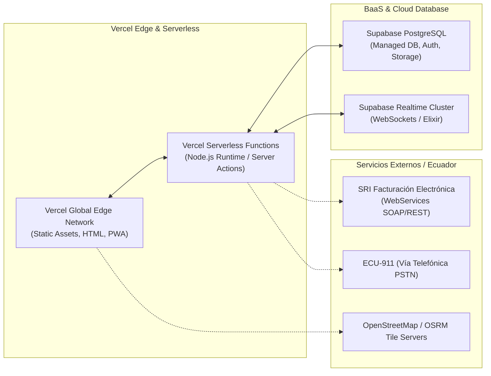

# INFORME DE AUDITORÍA GLOBAL & PROGRAMA DE INGENIERÍA SARA-FLETES V2
## 08. Infraestructura, DevOps, SRE y Continuidad Operativa

**Documento:** 08 de 21  
**Alcance:** Despliegue en Vercel, conectividad con Supabase, observabilidad, manejo de fallos y resiliencia en zonas de baja cobertura celular.  

---

### 1. Topología de Infraestructura y Despliegue

- **Plataforma de Despliegue:** Vercel Pro / Enterprise (`https://sara-constructora.vercel.app`).
- **Framework de Renderizado:** Next.js 16.3.4 (App Router con Server Components y Server Actions ejecutados en entorno Serverless de Node.js).
- **Base de Datos y Autenticación:** Supabase (PostgreSQL 15+ con extensiones `uuid-ossp` y soporte geoespacial).
- **Mapas y Geodatos:** OpenStreetMap (OSM) y CartoDB Tiles consumidos client-side a través de Leaflet.

---

### 2. Puntos Únicos de Fallo (SPOF) y Riesgos de Continuidad

1. **Dependencia de Tiles de OpenStreetMap sin Caché Local:**
   - Si los servidores públicos de OpenStreetMap o CartoDB experimentan cortes o aplican rate limiting a la IP de Vercel/cliente, los mapas de fletes no cargarán la capa base, mostrando un lienzo gris.
   - *Mitigación:* Implementar Service Worker PWA para almacenamiento en caché de tiles vectoriales en los corredores viales más transitados del país (E35, E25, E40).
2. **Conexión Celular Intermitente en Zonas Rurales y de Montaña del Ecuador:**
   - Corredores críticos como la vía Alóag-Santo Domingo, Km 49 Molleturo-Cuenca o la vía Catamayo-Cariamanga presentan túneles y cañones con pérdida total de señal 4G/LTE.
   - *Comportamiento Actual:* `BroadcastChannel` solo funciona si las dos vistas corren en el mismo equipo. Si un camión pierde señal, las actualizaciones de telemetría fallan y el rastreo satelital público se congela.
   - *Mitigación SRE:* Arquitectura *Store-and-Forward* en la PWA del transportista: almacenamiento local en IndexedDB de los puntos GPS y firmas ePOD durante el corte de señal, con sincronización por lotes (`batch sync`) y reintentos automáticos al recuperar conectividad.
3. **Manejo de Tiempos de Espera (Timeouts) en Server Actions:**
   - Las Server Actions de billetera prepago no tienen configurado un timeout explícito. Si Supabase presenta latencia alta, la UI puede bloquearse indefinidamente sin mensaje de error claro al usuario.
   - *Mitigación:* Envolver las llamadas en un `Promise.race()` con timeout de 8,000 ms y circuit breaker.

---

### 3. Matriz de Recuperación ante Desastres (DRP)

| Escenario de Falla | Probabilidad | Impacto | Comportamiento Actual | Plan de Resiliencia Recomendado |
|---|---|---|---|---|
| Caída del servidor Supabase | Baja | Crítico | Cae silenciosamente a `localStorage` (Demo funciona, BD no guarda) | Banner visible de "Modo Offline Activo", cola de sincronización en IndexedDB |
| Caída del CDN de Vercel | Muy Baja | Crítico | Plataforma inaccesible | PWA con Service Worker activo permite consultar fletes cacheados |
| Chofer pierde señal 4G en ruta | Alta | Medio | Rastreo se congela en último punto | Mostrar en el mapa "Última ubicación hace X minutos", reconexión en background |
| Salto de balance por doble click | Alta | Alto | Mitigado por `idempotency_key` en Server Action | Validado: se rechaza la transacción duplicada devolviendo el saldo existente |
