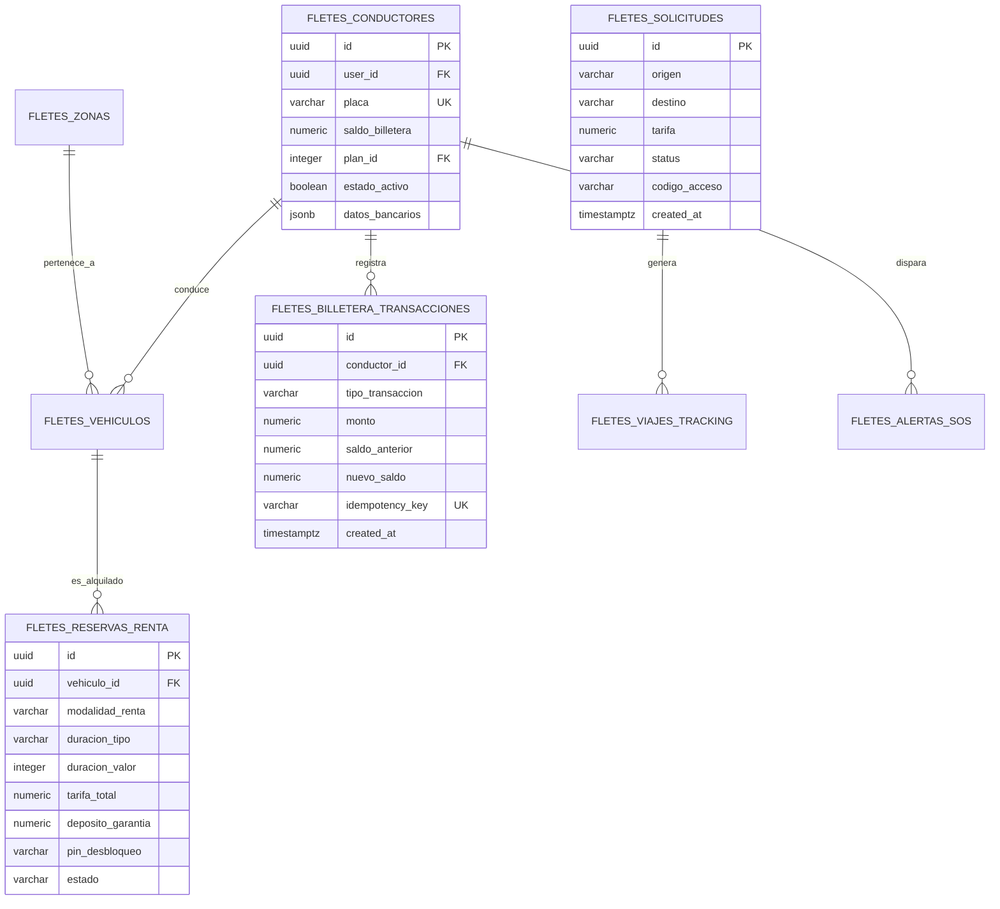

# INFORME DE AUDITORÍA GLOBAL & PROGRAMA DE INGENIERÍA SARA-FLETES V2
## 09. Integridad de Base de Datos, Esquemas, RLS y Transacciones

**Documento:** 09 de 21  
**Alcance:** Modelado relacional, constraints, funciones almacenadas RPC, bloqueo FOR UPDATE, Row Level Security (RLS) y dobles partidas.  

---

### 1. Modelo Entidad-Relación de SARA-FLETES

Los esquemas oficiales residen en los scripts DDL del repositorio:
- `supabase/fletes_vehiculos_zonas_renta_schema.sql` (206 líneas)
- `supabase/fletes_wallet_zero_trust_hardening.sql` (299 líneas)



---

### 2. Auditoría de Procedimientos Atómicos ACID y Concurrencia

En `supabase/fletes_wallet_zero_trust_hardening.sql` se definió la función PL/pgSQL:
`fn_debitar_comision_conductor_seguro(p_user_id, p_flete_id, p_tarifa_flete, p_idempotency_key)`.

#### Aspectos Positivos Verificados:
1. **Bloqueo Exclusivo de Fila (`FOR UPDATE`):**
   ```sql
   SELECT c.id, c.saldo_billetera, COALESCE(p.comision, 10.00) AS comision_pct
   INTO v_conductor
   FROM public.fletes_conductores c
   WHERE c.user_id = p_user_id
   FOR UPDATE OF c;
   ```
   Garantiza que dos débitos concurrentes sobre el mismo chofer no provoquen condiciones de carrera (*Race Conditions*) ni inconsistencias de saldo.
2. **Control Estricto de Idempotencia:**
   Verifica si `p_idempotency_key` ya existe en `fletes_billetera_transacciones`. Si existe, retorna el saldo anterior sin descontar nuevamente.
3. **Invariante de Saldo:**
   Lanza una excepción `SALDO_INSUFICIENTE` si el saldo del chofer es menor que la comisión requerida, impidiendo que la billetera entre en números rojos no autorizados.

#### Riesgos y Brechas Identificadas:
- **Ausencia de Ejecución Garantizada del Script en la Instancia Remota:**
  La Server Action `saraFletesWalletActions.ts` contiene un bloque `try/catch` que intenta invocar `supabase.rpc('fn_debitar_comision_conductor_seguro')`, pero si la función no ha sido migrada en Supabase Cloud, cae a un fallback de actualización directa en Node.js que **no tiene bloqueo FOR UPDATE**:
  ```typescript
  // Fallback en Node.js sin FOR UPDATE
  const { data: conductor } = await supabase.from('fletes_conductores').select(...);
  // Ventana vulnerable de carrera aquí
  await supabase.from('fletes_conductores').update({ saldo_billetera: nuevoSaldo });
  ```
  *Acción Requerida:* Asegurar que la migración DDL se aplique de forma mandatoria en el cluster de Supabase y eliminar fallbacks no transaccionales en operaciones contables.

---

### 3. Políticas de Seguridad de Fila (Row Level Security - RLS)

- **`fletes_billetera_transacciones`:** Debe ser inmutable (`INSERT` permitido solo vía Server Actions / Service Role o RPC, `UPDATE` y `DELETE` denegados para todos los roles).
- **`fletes_conductores`:** `SELECT` público permitido para datos operativos de transporte (placa, modelo, nombre, calificación), pero campos sensibles como `saldo_billetera` y `datos_bancarios` deben estar protegidos para que solo el propio chofer (`auth.uid() = user_id`) o el rol administrador puedan leerlos.
- **`fletes_alertas_sos`:** `INSERT` permitido a cualquier usuario autenticado; `SELECT` y `UPDATE` restringidos a la central de seguridad y al propio emisor.
