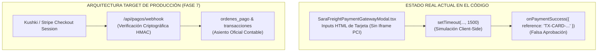

# INFORME DE AUDITORÍA GLOBAL & PROGRAMA DE INGENIERÍA SARA-FLETES V2
## 10. Integridad Financiera, Pasarelas de Pago y Algoritmos de Tarificación

**Documento:** 10 de 21  
**Alcance:** Modelado de tarifas dinámicas, comisiones de plataforma, pasarelas de pago, cobros y liquidación a transportistas.  

---

### 1. Modelo Matemático de Tarificación Dinámica

El cálculo de tarifas en `SaraFreightPricingService.calcularTarifa` divide la operación en dos regímenes geográficos y normativos:

#### Régimen A: Flete Local Urbano ($D \le 5.0\,\text{km}$)
Para carreras intraurbanas cortas (movilización de materiales dentro de una misma ciudad o cantón, ej. Cariamanga, Loja, Cuenca):

$$\text{Tarifa}_{\text{Local}} = \max\left(\text{TarifaMinima}, (\text{Banderazo} + (D \cdot C_{\text{km}}) + (\min(P, C_{\text{ton}}) \cdot C_{\text{ton\_local}})) \cdot F_{\text{material}}\right)$$

Donde:
- $D$: Distancia geodésica en kilómetros.
- $P$: Peso de la carga en toneladas.
- $C_{\text{ton}}$: Capacidad máxima del vehículo seleccionado.
- $F_{\text{material}}$: Factor de complejidad del material (Cemento: $1.05$, Varillas de acero $12\text{m}$: $1.15$, Escombros: $1.20$, Otros: $1.00$).

#### Régimen B: Flete Interurbano / Interprovincial ($D > 5.0\,\text{km}$)
Para transporte entre cantones y provincias a través de la Red Vial Estatal del Ecuador:

$$\text{Tarifa}_{\text{Inter}} = \max\left(2 \cdot \text{TarifaMinima}, (\text{Banderazo} \cdot 1.5 + (D \cdot S_{\text{vial}} \cdot C_{\text{km\_inter}}) + (P \cdot C_{\text{ton\_km\_inter}} \cdot D) + \text{Peajes}) \cdot F_{\text{material}}\right)$$

Donde:
- $S_{\text{vial}} = 1.25$: Factor de sinuosidad vial que compensa curvas de cordillera andina frente a la distancia euclidiana en línea recta.
- $\text{Peajes}$: Cálculo de peajes según distancia interprovincial ($\lfloor D / 60 \rfloor \times \text{TarifaPeaje}$).

---

### 2. Estructura de Comisiones y Planes de la Plataforma

SARA-FLETES implementa un modelo de prepago (*Prepaid Wallet*) donde el transportista recarga saldo y la plataforma debita automáticamente una comisión porcentual por cada carrera finalizada:

| Plan | Comisión de Plataforma | Margen Neto del Chofer | Soporte y Beneficios |
|---|---|---|---|
| **Plan Básico** | $10.0\%$ | $90.0\%$ | Asignación estándar en radar, soporte por correo |
| **Plan Estándar** | $20.0\%$ | $80.0\%$ | Asignación prioritaria, soporte WhatsApp 24/7 |
| **Plan VIP** | $30.0\%$ | $70.0\%$ | Acceso exclusivo a obras civiles de gran volumen de GRUPO SARA y contratos SERCOP |

*Invariante Contable de la Billetera:*
$$\text{NuevoSaldo} = \text{SaldoAnterior} - (\text{TarifaFlete} \times \text{ComisionPct})$$
Si $\text{SaldoAnterior} < \text{ComisionDebitada}$, el sistema bloquea la asignación para choferes en modalidad prepago.

---

### 3. Diagnóstico de la Pasarela de Pagos (Stripe / Kushki / Deuna)

- **Riesgo:** Como se documentó en el hallazgo `SEC-FLT-004`, el modal actual no procesa cobros bancarios reales.
- **Cobros QR (Deuna / Payphone / Banco Guayaquil):**
  La integración actual despliega los datos del transportista (teléfono Deuna, cuenta de ahorros y foto del QR) para que el cliente pague externamente desde su app móvil bancaria. Este flujo de "Transferencia Directa P2P" es legítimo en Ecuador, pero la confirmación en SARA-FLETES es manual (el cliente sube la referencia o marca "Pago Realizado").
- **Recomendación:** Para fletes entre particulares y choferes, mantener el modo QR P2P con comprobante fotográfico subido a Supabase Storage y validado por el chofer; para obras corporativas de GRUPO SARA, implementar liquidación con factura electrónica SRI y retención en la fuente (Códigos 344/312).
