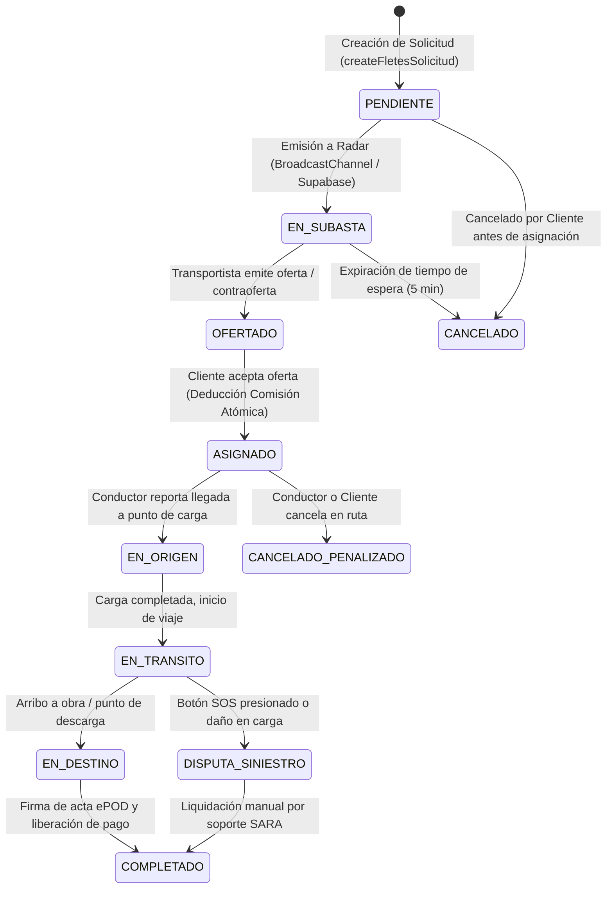

# INFORME DE AUDITORÍA GLOBAL & PROGRAMA DE INGENIERÍA SARA-FLETES V2
## 12. Procesos Logísticos Distribuidos y Matriz de Fallos

**Documento:** 12 de 21  
**Alcance:** Modelado formal de transiciones de estado, concurrencia, idempotencia, sincronización entre agentes y resiliencia de red.  

---

### 1. Máquina de Estados del Flete

---

### 2. Matriz de Resiliencia ante Fallos en Procesos Distribuidos

| Escenario de Falla | Condición / Causa Raíz | Comportamiento Esperado | Comportamiento Actual en Código | Prueba y Remediación |
|---|---|---|---|---|
| **Doble Aceptación Concurrente** | Dos transportistas aceptan la misma carrera con milisegundos de diferencia. | Bloqueo transaccional `SELECT FOR UPDATE`. Uno gana, el segundo recibe notificación de "Flete ya asignado" sin débito de comisión. | Ambos clientes emiten `FLETE_ACEPTADO` en BroadcastChannel local. En entorno remoto sin lock, se debitarían comisiones a ambos. | **FLT-CON-001:** Ejecutar función RPC con bloqueo exclusivo a nivel de fila en PostgreSQL. |
| **Pérdida de Conectividad en Ruta** | El camión cruza un tramo sin cobertura celular (e.g. Cañón del Río León, Molleturo). | La app del chofer almacena puntos GPS localmente en IndexedDB. El rastreo público muestra "Última señal hace X min". | El mapa se congela en el último punto recibido. Al reconectar, no se envían los puntos intermedios omitidos. | **FLT-NET-001:** Implementar cola de almacenamiento *Store-and-Forward* en PWA para reenvío masivo al recuperar 4G. |
| **Reintento Agresivo de Usuario** | El cliente presiona repetidamente el botón "Confirmar Pedido" por latencia de red. | Idempotencia estricta en servidor. Solo se crea una fila en `fletes_solicitudes`. | Si la red tarda, el cliente puede disparar múltiples llamadas `createFletesSolicitud`, creando solicitudes duplicadas con distintos IDs. | **FLT-IDP-001:** Generar `client_request_id` único en el navegador antes de la primera llamada y restringir con índice único en BD. |
| **Discrepancia en Entrega de Carga** | El receptor afirma que llegaron 90 sacos de cemento en vez de los 100 pactados. | El acta ePOD permite registrar `conformidad: 'OBSERVACION_LEVE'` o `'DANOS_REPORTADOS'` con notas y retención de garantía. | Implementado en `SaraEpodModal`: permite seleccionar estado de conformidad y guardar observaciones fotográficas. | Verificado positivamente en componente ePOD. |
| **Falsa Alarma SOS** | Chofer presiona accidentalmente el botón SOS durante un bache en carretera. | Ventana de cancelación de 10 segundos antes del escalamiento a centrales de auxilio. | La pulsación requiere 2.5s continuos, mitigando toques accidentales. Permite desactivar la alerta con botón explícito. | Verificado positivamente en `SaraFloatingSosButton`. |
