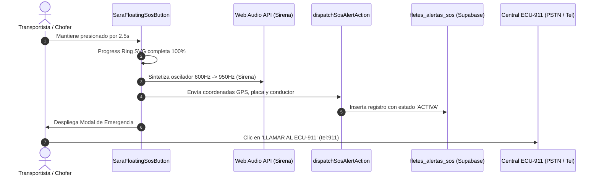

# INFORME DE AUDITORÍA GLOBAL & PROGRAMA DE INGENIERÍA SARA-FLETES V2
## 14. Seguridad Operativa, Botón SOS y Prevención de Fraude

**Documento:** 14 de 21  
**Alcance:** Protocolos de emergencia en carretera, botón SOS, filtro cinemático Kalman y prevención de fraude telemático.  

---

### 1. Auditoría del Mecanismo SOS de Emergencia

#### Dictamen Técnico del Botón SOS:
- **Mecanismo Físico/Visual:** Excelente diseño preventivo. Exige 2.5 segundos de presión continua, eliminando toques accidentales causados por vibraciones del camión o baches.
- **Canal de Audio:** Genera sonido de alerta audible en cabina para disuadir posibles asaltos o intentos de secuestro de carga.
- **Integración con Fuerzas de Seguridad:**
  - El botón **NO** posee un webhook bidireccional automatizado con la plataforma CAD (*Computer Aided Dispatch*) del Servicio Integrado de Seguridad ECU-911.
  - El enlace activa el discador telefónico nativo del celular (`tel:911`), delegando la comunicación vocal al conductor.
  - En la base de datos se registra la coordenada exacta y la velocidad en la tabla `fletes_alertas_sos` para auditoría de la central interna de GRUPO SARA.
  - *Veredicto:* La función es semireal: ofrece alerta local y registro centralizado, pero no debe presentarse como despacho policial autónomo sin intervención humana.

---

### 2. Algoritmo Antifraude Telemático (`SaraFreightGpsAntiFraud`)

El motor de ciberseguridad cinemática implementa 4 filtros matemáticos sobre cada muestra sucesiva de GPS:

1. **Filtro de Velocidad Máxima Permitida:**
   $$V_{\text{calculada}} = \frac{D_{\text{Haversine}}(P_1, P_2)}{\Delta t}$$
   Si $V_{\text{calculada}} > 130.0\,\text{km/h}$, se marca inmediatamente como `isMockSuspected: true` con `threatLevel: 'CRITICAL'`. Ningún camión pesado o volqueta en la red vial del Ecuador puede superar físicamente esta velocidad.
2. **Detección de Mock Locations por Precisión Artificial Fija:**
   Los emuladores de software en computadoras o aplicaciones de Mock GPS en Android suelen reportar una precisión de `accuracy = 0.0m` o `< 0.1m`. Los receptores GPS reales satelitales en carretera siempre presentan dispersión de señal ($3.0\text{m} \le \text{accuracy} \le 25.0\text{m}$). El sistema marca anomalías de precisión con `threatLevel: 'MEDIUM'`.
3. **Consistencia de Estampilla Temporal:**
   Si la muestra entrante tiene un $\Delta t \le 0\,\text{ms}$, se rechaza por corrupción telemática con `threatLevel: 'HIGH'`.

---

### 3. Protocolos de Prevención de Fraude en Obra

1. **Firma Digital ePOD en Canvas Inviolable:**
   La firma del receptor se estampa sobre un lienzo vectorial con trazo suave y se acompaña del número de cédula, cargo y nombre verificado.
2. **Precinto de Seguridad y Odómetro:**
   Se obliga al transportista a reportar el kilometraje de llegada y el código alfanumérico del precinto de la tolva/furgón, impidiendo el "ordeño" o sustracción parcial de combustible y materiales en trayectos largos.
3. **Código PIN de Validación de Carga:**
   Cada flete genera un código secreto de 4 dígitos que el cliente despachador entrega al chofer solo cuando el camión está cargado en el andén, garantizando la presencia física en el punto de origen.
