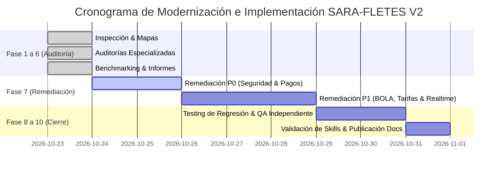

# INFORME DE AUDITORÍA GLOBAL & PROGRAMA DE INGENIERÍA SARA-FLETES V2
## 19. Hoja de Ruta de Modernización y Matriz de Priorización (P0 - P3)

**Documento:** 19 de 21  
**Alcance:** Plan de acción estructurado por fases, criterios de cierre y estimación de esfuerzo técnico.  

---

### 1. Criterios de Clasificación de Prioridad

- **P0 (Riesgo Crítico / Contención Inmediata):** Vulnerabilidades de seguridad con impacto financiero o fuga de datos sensibles, inputs de tarjeta sin PCI-DSS, o mutaciones client-side que afecten fondos reales.
- **P1 (Riesgo Alto / Arquitectura Central):** Fallbacks silenciosos que impiden la persistencia real en Supabase, BOLA/IDOR en Server Actions, o dependencia exclusiva de BroadcastChannel local entre dispositivos móviles.
- **P2 (Mejora Relevante / Experiencia Operativa):** Descomposición modular de componentes monolíticos (`page.tsx`), PII en rastreo satelital, geocercas activas en servidor y exportaciones dinámicas (lazy loading).
- **P3 (Mejora Incremental / Pulido UI):** Trampas de foco en accesibilidad, vibración háptica en cabina, animaciones menores y refinamiento de textos.

---

### 2. Matriz Consolidada de Hallazgos y Tareas

| ID Tarea | Descripción del Trabajo | Prioridad | Módulo / Archivo Afectado | Complejidad | Impacto | Criterio de Aceptación / Cierre |
|---|---|---|---|---|---|---|
| **TSK-001** | Desactivar inputs reales de tarjeta en `SaraFreightPaymentGatewayModal` y advertir modo demostración / Sandbox | **P0** | `SaraFreightPaymentGatewayModal.tsx` | Baja | Alto | No se recopilan datos PAN/CVV en state de React |
| **TSK-002** | Eliminar fallback a `localStorage` para saldos y obligar lectura en `fletes_conductores` | **P0** | `fletes-data.ts`, `saraFletesWalletActions.ts` | Media | Crítico | Modificar `localStorage` en consola no altera el saldo |
| **TSK-003** | Mitigar IDOR en `debitDriverCommissionAction`: verificar `auth.uid() === conductor.user_id` | **P1** | `saraFletesWalletActions.ts` | Media | Alto | Intento de débito sobre placa ajena arroja `403 FORBIDDEN` |
| **TSK-004** | Validar tarifa en servidor al crear flete: rechazar valores fuera de $[-15\%, +30\%]$ | **P1** | `createFletesSolicitud`, Server Action | Media | Alto | Manipular `tarifa: 0.01` en HTTP es rechazado con `INVALID_FARE` |
| **TSK-005** | Integrar Supabase Realtime Channels (`supabase.channel('fletes_radar')`) para sincronización móvil remota | **P1** | `saraFletesRealtimeService.ts` | Alta | Crítico | Mensajes recibidos en dos teléfonos celulares separados |
| **TSK-006** | Enmascarar celular del conductor en `/fletes/rastreo/[token]` exigiendo PIN de entrega | **P2** | `src/app/fletes/rastreo/[token]/page.tsx` | Baja | Medio | Celular oculto hasta ingresar el PIN de 4 dígitos |
| **TSK-007** | Descomponer `page.tsx` (2,955 líneas) en submódulos especializados de Cotizador, Mapa y Subasta | **P2** | `src/app/modulos/fletes/` | Alta | Medio | Ningún archivo supera las 500 líneas; tests verdes |
| **TSK-008** | Implementar Lazy Loading en librerías pesadas `xlsx` y `jspdf` | **P2** | `src/app/admin/fletes/page.tsx` | Baja | Medio | Bundle inicial de JS reducido en $\sim 450\,\text{KB}$ |
| **TSK-009** | Incorporar `aria-modal="true"` y Focus Trap en modales de firma ePOD y Pagos | **P3** | `SaraEpodModal.tsx`, `SaraFreightPaymentGatewayModal.tsx` | Baja | Bajo | Navegación accesible con teclado cumple WCAG AA |

---

### 3. Fases de Ejecución del Programa SARA-FLETES V2

